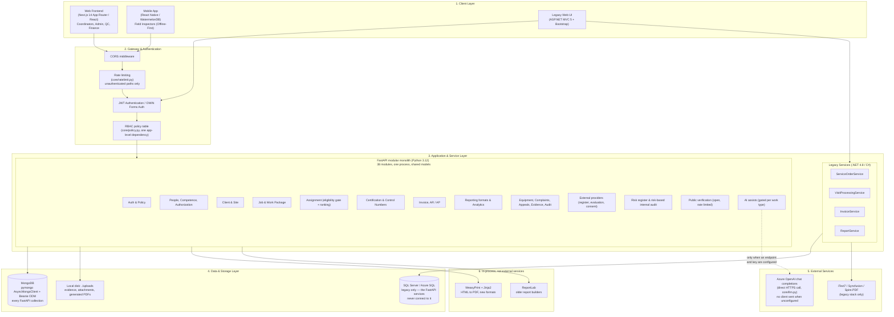
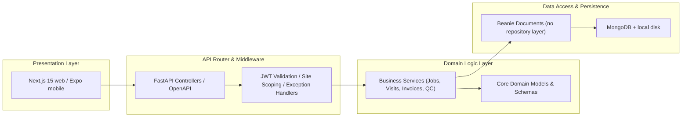
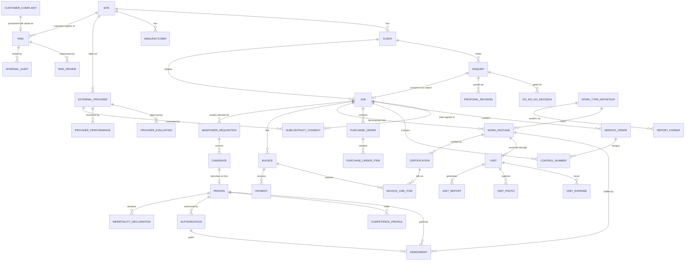
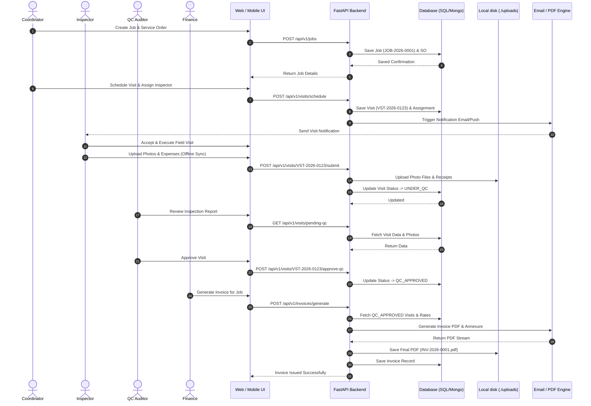
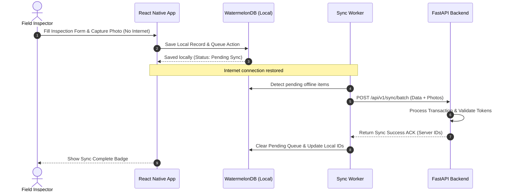

# IQE (Ideal Quality Engineers) - Architecture & End-to-End Flow Specification

This document provides a comprehensive technical reference for the **Architecture Flow (Arch Flow)** and **End-to-End Workflow (E2E Flow)** of the **IQE (Ideal Quality Engineers) Inspection Management System**. It covers the system architecture, dual-stack implementation (modern Next.js/FastAPI vs legacy ASP.NET MVC), entity data models, detailed lifecycle phases, sequence diagrams, and security matrix.

---

## 1. Executive Overview

IQE is an enterprise-grade Fieldglass-style Job & Inspection Management Platform designed to streamline third-party inspection (TPI), quality control (QC), site technician scheduling, field data/photo capture, financial billing, and automated reporting.

The system centers around a **Job ID (`job_id`) umbrella concept**—a single reference number linking all operational entities:
```
Enquiry ──▶ Go/No-Go Gate ──▶ Proposal (Rev n) ──▶ Award
                                                     │
Client / Site ──▶ Job ID (Umbrella) ──▶ Service Order ──▶ Control Number
                                                     │
                                          Work Package (by Work Type)
                                                     │
                                          Assignment (Inspection Officer)
                                                     │
                                          Visit Schedule / Measurement
                                                     │
                                    Field Inspection (Docs, Photos, Expenses)
                                                     │
                                          Quality Control (QC)
                                                     │
                                    Certification (claimed vs certified value)
                                                     │
                                          Finance Approval
                                                     │
                                          Invoice & Annexure
```

> **Document set.** This file covers the operational spine. Two companion specifications
> extend it at either end and are referenced throughout:
> - [`PEOPLE_AND_PRESALES_SPEC.md`](./PEOPLE_AND_PRESALES_SPEC.md) — enquiry → go/no-go →
>   award, and the people/competence/authorization model feeding assignment.
> - [`SOW_EXECUTION_ARCHITECTURE.md`](./SOW_EXECUTION_ARCHITECTURE.md) — work types, work
>   packages, assignment, certification, billing bases and the AI roster engine.
>
> Sections below marked **(planned)** describe the target state defined in those specs and
> are not yet implemented.

---

## 2. Architecture Flow (Arch Flow)

### 2.1 High-Level System Architecture



> **Edition.** The quality-system modules were built against **ISO/IEC
> 17020:2026**, published 27 March 2026; accreditations under the 2012
> edition cease to be recognised on 27 March 2029. Clause references in code
> comments elsewhere in this repository still cite 2012 numbering and have not
> been rechecked against the 2026 text — the revision restructured the
> standard, so treat those citations as indicative until someone with the
> standard in hand confirms them.
>
> **Rate limiting** covers the unauthenticated paths only — login, refresh,
> the public `/v/` short link, and `/api/v1/verify/{reference}`
> (`core/ratelimit.py`). The limiter keys on the matched rule prefix rather
> than the request path, without which a parameterised endpoint gives an
> enumerator a fresh allowance on every reference. Authenticated
> routes are deliberately not limited: a number for those is a capacity
> decision about real work, and picking one without measuring would break a
> coordinator's bulk import to defend against a threat the token already
> addresses. Counters live in process memory, so N workers means N times the
> limit; for more than one host the limit belongs in the reverse proxy.
>
> **Email notification is not built.** `sendgrid_api_key` sits in
> `core/config.py` and is never read. Sending needs a verified sender domain
> and a decision about what is sent to whom — neither of which is a coding
> task — and a notifier that silently drops messages is worse than none,
> because the coordinator believes the inspector was told. Assignment is
> currently communicated outside the system.
>
> Redis is wired (`core/cache.py`) but the application runs without it.

---

### 2.2 Dual-Stack Architecture Comparison

IQE supports both a modernized decoupled architecture and the existing legacy enterprise framework:

| Architecture Layer | Modern Stack (Target) | Legacy Stack (Operational) |
| :--- | :--- | :--- |
| **Frontend UI** | Next.js 15 (App Router, React 19, Tailwind CSS 3.4, TypeScript) | ASP.NET MVC 5 (Razor, Bootstrap 5, jQuery, Dropzone.js, jsTree) |
| **Mobile Client** | Expo / React Native 0.76 — 11 screens for inspector and coordinator, `expo-camera` and `expo-location`. No offline sync layer is built. | N/A (Responsive Web) |
| **Backend API** | FastAPI (Python 3.12, async, Pydantic v2 schemas) | ASP.NET Web API 2 / MVC 5 Controllers (.NET Framework 4.8) |
| **Data Access** | `pymongo.AsyncMongoClient` + Beanie ODM. Not Motor, and no SQL driver: the FastAPI services hold no connection to SQL Server. | Dapper ORM (Stored Procedures), Entity Framework 6 |
| **Primary Data Stores** | MongoDB only | SQL Server (`IQEIMS_DEV` / `IQEIMS`) |
| **File Storage** | Local disk, `./uploads`, path-validated on write | Azure Blob Storage + Physical `D:\IQEApp\FileStorage\` |
| **PDF Processing** | WeasyPrint + Jinja2 for the inspection formats; ReportLab in the older report builders. Both run in-process. | iTextSharp, iText7, Syncfusion.Pdf, Spire.PDF |
| **Authentication** | Bearer JWT (HS256) + a single RBAC policy table applied as an app-level dependency | OWIN Katana Cookie Auth + Forms Authentication + CustomAuthorize Filter |
| **AI / Intelligence** | Direct Azure OpenAI chat-completions call. The deterministic assists (completeness, outliers, checklist) use no model at all. No LangChain, no RAG, no vision. | Built-in analytics & static reporting |

> **"Micro-Modules" was never accurate.** The FastAPI side is a modular
> monolith: 38 modules in one process, one database, and 63 cross-module model
> imports. The modules are a code-organisation boundary, not a deployment one.
> Splitting them would mean untangling those imports first.

---

### 2.3 Layered Architecture Breakdown



---

## 3. Data Model & Entity Relationship (ER)

### 3.1 Umbrella Job Entity ID Structure

Every entity in IQE carries its own unique identifier and references the root `job_id` and `site_id` for tenant isolation.



> Every entity in this diagram now exists in code. `ENQUIRY` gating,
> `GO_NO_GO_DECISION` and `PROPOSAL_REVISION` were the last outstanding ones and were
> built in October 2026 (`modules/enquiries/`); `WORK_PACKAGE`, `ASSIGNMENT`,
> `CERTIFICATION`, `PERSON` and the authorization chain were built earlier in the same
> period. `VISIT_ASSIGNMENT` is superseded by `ASSIGNMENT`,
> which attaches to the work package rather than the visit so that one assignment can span
> several visits.

### 3.2 Key Entity Identifier Standards

| Entity | ID Schema | Parent Reference | Description |
| :--- | :--- | :--- | :--- |
| **Site** | `SITE-XX` | — | Multi-tenant branch location |
| **Client** | `CLT-XXXX` | Site | Corporate client ordering inspections |
| **Manufacturer** | `MFR-XXXX` | Site | Vendor/Factory site being inspected |
| **User / Inspector** | `USR-XXXX` | Site | Staff member, coordinator, or field technician |
| **Job (Umbrella)** | `JOB-YYYY-XXXX` | Client | Single reference container for overall engagement |
| **Service Order** | `SO-YYYY-XXXX` | Job | Scope of inspection work contract |
| **Control Number** | `CN-YYYY-XXXX` | Job / SO | Individual tag/batch allocated for inspection |
| **Purchase Order** | `PO-YYYY-XXXX` | Job | Client PO billing reference |
| **Visit** | `VST-YYYY-XXXX` | Job / CN / Work Package | Scheduled field inspection event |
| **Inspection Photo** | `PHO-XXXX` | Visit | Photo evidence taken on site |
| **Visit Expense** | `EXP-XXXX` | Visit | Inspector travel, lodging, or meal claim |
| **Invoice** | `INV-YYYY-XXXX` | Job / Visit | Financial invoice issued to client |
| **Payment** | `PAY-YYYY-XXXX` | Invoice | Client payment settlement record |

**Quality-system identifiers** (ISO/IEC 17020:2026, built October 2026):

| Entity | ID Schema | Parent Reference | Defined in |
| :--- | :--- | :--- | :--- |
| **External Provider** | `PRV-YYYY-XXXX` | Site | `modules/providers/` |
| **Provider Evaluation** | `PEV-YYYY-XXXX` | External Provider | `modules/providers/` |
| **Provider Observation** | `PMR-YYYY-XXXX` | External Provider | `modules/providers/` |
| **Subcontract Consent** | `PSC-YYYY-XXXX` | Job + External Provider | `modules/providers/` |
| **Risk** | `RSK-YYYY-XXXX` | Site | `modules/risk/` |
| **Risk Review** | `RVW-YYYY-XXXX` | Risk | `modules/risk/` |
| **Internal Audit** | `IAU-YYYY-XXXX` | Site | `modules/risk/` |

**Planned identifiers** (companion specs):

| Entity | ID Schema | Parent Reference | Defined in |
| :--- | :--- | :--- | :--- |
| **Enquiry** | `ENQ-YYYY-XXXX` | Client | People & Pre-Sales §5.4 |
| **Go/No-Go Decision** | `GNG-YYYY-XXXX` | Enquiry | People & Pre-Sales §5.4 |
| **Proposal** | `QTN-YYYY-XXXX` (+ `Rev n`) | Enquiry | People & Pre-Sales §5.4 |
| **Work Package** | `WP-YYYY-XXXX` | Job / Service Order | SOW Execution §3.1 |
| **Assignment** | `ASG-YYYY-XXXX` | Work Package | SOW Execution §3.2 |
| **Certification** | `CERT-YYYY-XXXX` | Work Package | SOW Execution §4.2 |
| **Person / Employee** | `EMP-XXXXX` | Site | People & Pre-Sales §5.4 |
| **Authorization** | `ATH-YYYY-XXXX` | Person | People & Pre-Sales §5.4 |
| **Manpower Requisition** | `REQ-YYYY-XXXX` | Job / standalone | People & Pre-Sales §5.4 |
| **Candidate** | `CND-YYYY-XXXX` | Requisition | People & Pre-Sales §5.4 |

> **Visit prefix — resolved to `VST-`.** The runtime generator
> (`backend/modules/visits/service.py`) emits `VST-YYYY-NNN`, the model documents `VST-`, and
> the web app (`visit-schedule`, `logsheet`, `visits/new`) uses it throughout, so `VST-` is the
> live format. The docs, `seed_full_pipeline.py` and the job-detail mock data previously said
> `VIS-` and have been corrected.
>
> Two namespaces are deliberately left as-is:
> - `LEG-VIS-###` — legacy source-system visit references, a distinct namespace by design.
> - `VIS-MIG-###-#` in `backend/modules/jobs/migration.py` — the migration generator. It is
>   idempotent on `visit_id`, so changing the prefix would make a re-run insert duplicates of
>   already-migrated visits rather than skip them. **Action required:** if that migration has
>   run against any live database, rename existing `VIS-MIG-*` records to `VST-MIG-*` and
>   change the generator in the same release. If it has not run anywhere, the generator can be
>   changed on its own.

---

## 4. End-to-End Workflow (E2E Flow)

### 4.1 Master End-to-End Process Flow

```mermaid
flowchart TD
    Start([User Request / Login]) --> Auth{Authenticated?}
    Auth -- No --> Login[Prompt Credentials / SSO] --> Auth
    Auth -- Yes --> Dash[Load Dashboard according to User Role]

    %% Phase 0: Pre-sales (planned)
    Dash --> P0[Phase 0: Enquiry & Go/No-Go - planned]
    P0 --> ENQ[Enquiry: ENQ-YYYY-XXXX]
    ENQ --> GATE{Go / No-Go gate}
    GATE -- No-Go --> REMEDY[Record reason code & remediate]
    REMEDY --> GATE
    GATE -- Go --> QTN[Proposal: QTN-YYYY-XXXX Rev n]
    QTN --> AWARD{Client decision}
    AWARD -- Lost --> REMEDY
    AWARD -- Won --> P1

    %% Phase 1: Initiation
    P1[Phase 1: Job & Service Order Creation]
    P1 --> SelectClient[Select / Create Client & Manufacturer]
    SelectClient --> CreateJob[Initialize Job Umbrella ID: JOB-YYYY-XXXX]
    CreateJob --> CreateSO[Create Service Order & PO Details]

    %% Phase 1b: Work packages (planned)
    CreateSO --> P1B[Phase 1b: Work Package Breakdown - planned]
    P1B --> WP[Create Work Packages: WP-YYYY-XXXX<br/>each typed by Work Type]
    WP --> ASG[Assign Inspection Officer: ASG-YYYY-XXXX<br/>hard competence gate then AI ranking]

    %% Phase 2: Scheduling
    ASG --> P2[Phase 2: Control Number & Visit Scheduling]
    P2 --> AssignCN[Generate Control Numbers: CN-YYYY-XXXX]
    AssignCN --> ScheduleVisit[Schedule Field Visit]
    ScheduleVisit --> NotifyInsp[Dispatch Notification to Inspector Web/Mobile]

    %% Phase 3: Execution
    NotifyInsp --> P3[Phase 3: Field Execution & Data Capture]
    P3 --> AcceptVisit[Inspector Accepts Visit Schedule]
    AcceptVisit --> FieldCheckIn[Field GPS Check-in & Inspection]
    FieldCheckIn --> UploadData[Upload Checklist, Photos & Expense Receipts]

    %% Phase 4: QC
    UploadData --> P4[Phase 4: Quality Control & Audit Review]
    P4 --> QCAudit{QC Review Passed?}
    QCAudit -- No / Rejection --> RequestRework[Return Visit to Inspector for Rework] --> FieldCheckIn
    QCAudit -- Yes / Approved --> QCApprove[Approve Inspection Report]

    %% Phase 4b: Certification (planned)
    QCApprove --> P4B[Phase 4b: Certification - planned]
    P4B --> CERT[Certify: claimed vs certified qty<br/>CERT-YYYY-XXXX produces certified value]

    %% Phase 5: Finance & Billing
    CERT --> P5[Phase 5: Finance & Invoice Generation]
    P5 --> CalculateRates[Apply rate basis: hourly / man-day / per visit /<br/>per unit / lump sum / pct of certified value]
    CalculateRates --> DraftInv[Generate Draft Invoice & Annexures]
    DraftInv --> FinanceApprove{Finance Approved?}
    FinanceApprove -- Re-calc --> CalculateRates
    FinanceApprove -- Approved --> IssueInv[Publish Final PDF Invoice: INV-YYYY-XXXX]

    %% Phase 6: Reporting & Closing
    IssueInv --> P6[Phase 6: Reporting & Archival]
    P6 --> ExportPDF[Send Reports & Invoices to Client]
    ExportPDF --> PayTrack[Track Payment & Close Job Lifecycle]
    PayTrack --> End([Process Completed])
```



---

### 4.2 Detailed Phase Walkthrough

#### Phase 1: Authentication & Dashboard Initialization
1. **User Login**: User submits credentials via Next.js `/login` or mobile client.
2. **Token Generation**: FastAPI Auth service validates hashed password (Bcrypt), returns JWT Bearer token containing `user_id`, `role`, and `site_id`.
3. **Role Routing**:
   - **Coordinator**: Directed to Job Creation & Scheduling Console.
   - **Inspector**: Directed to Mobile Today's Visits & Offline Task Queue.
   - **QC Auditor**: Directed to Inspection Approval Queue.
   - **Finance**: Directed to Unbilled Visits & Invoice Management.

#### Phase 0: Enquiry, Go/No-Go & Award — **(planned)**
1. **Enquiry Capture**: Client RFQ recorded as `ENQ-YYYY-XXXX` with scope categories, site and dates.
2. **Go/No-Go Gate**: Weighted scorecard across scope fit, competence availability, geography, commercial viability, client credit and impartiality. System recommends; a named decision-maker decides; an override against the recommendation requires a reason.
3. **No-Go Loop**: Reason code recorded, remediation owned and dated (hire, subcontract, re-scope, re-price), then re-scored. A No-Go is never a dead end unless explicitly closed.
4. **Proposal & Revisions**: Priced as `QTN-YYYY-XXXX Rev 0`; every resubmission is an immutable new revision, never an edit.
5. **Award**: On win, the enquiry converts — `Job` is created and the enquiry carries `won_job_id`. On loss, a loss reason code is recorded and the enquiry can be revived.
> Full detail: [`PEOPLE_AND_PRESALES_SPEC.md`](./PEOPLE_AND_PRESALES_SPEC.md) §5.

#### Phase 2: Job & Service Order (SO) Initialization
1. **Client Selection**: Select existing client (`client_id`) and client unit.
2. **Job Container Creation**: System creates root `Job` document (`job_id`: e.g. `JOB-2026-0001`).
3. **Service Order Setup**: Attach contract terms, scope of inspection, client PO (`po_id`), and manufacturer unit.
4. **Document Attachment**: Upload client spec sheets or standards to `./uploads` on the application host. Object storage is not wired.

#### Phase 2b: Work Package Breakdown & Officer Assignment — **(planned)**
1. **Decomposition**: The Service Order scope is broken into `WorkPackage` records (`WP-YYYY-XXXX`), each carrying a `work_type_code` — code inspection, BOQ reconciliation, bill verification, GMP compliance, vendor audit, expediting, SAT, deputation.
2. **Work Type Drives Everything**: The type definition supplies the capture schema, required authorization, measurement basis, rate basis, report format and permitted AI assists. New work types are configuration, not new modules.
3. **Schedule Linkage**: Where the client supplies an MS Project / P6 schedule, packages bind to its task IDs and predecessors, making inspection demand predictable rather than reactive.
4. **Officer Assignment**: A two-stage engine — a hard eligibility gate (valid authorization covering the inspection type through the work window, no impartiality conflict, no calendar clash) then weighted ranking on skill depth, proximity, availability, workload and past performance. Authorization evidence is snapshotted onto the assignment.
> Full detail: [`SOW_EXECUTION_ARCHITECTURE.md`](./SOW_EXECUTION_ARCHITECTURE.md) §2–§3, §5.

#### Phase 3: Control Number Allocation & Visit Scheduling
1. **Control Number Generation**: Split Service Order into actionable control numbers (`control_number_id`).
2. **Inspector Matching**: Match technician competencies (`competency_id`), location proximity, and calendar availability. **(Planned: superseded by the gated assignment engine in Phase 2b — competence becomes a precondition rather than one weighted factor among several.)**
3. **Visit Creation**: Schedule visit (`visit_id`), allocating estimated mandays, start date, and target execution site.
4. **Notification**: **(not built)** Neither email nor mobile push is implemented. `sendgrid_api_key` exists in `core/config.py` and is never read; assignment is currently communicated outside the system.

#### Phase 4: Inspector Field Execution & Offline Data Sync
1. **Visit Acceptance**: Inspector confirms schedule via React Native app or mobile browser.
2. **GPS Check-In**: Inspector arrives at manufacturer site; app records GPS coordinates and timestamp.
3. **Inspection Data Capture**:
   - Executes inspection checklists.
   - Captures high-res photos (`photo_id`) with timestamps and watermark overlay.
   - Logs daily expenses (`expense_id`) and attaches receipt scans.
4. **Offline Resilience**: **(not built)** The Expo app has no offline store and no sync worker — it calls the API directly and fails when the site has no signal, which on a construction site is most of the time. This is the largest single gap between this document and the code.

#### Phase 5: Quality Control (QC) & AI Verification
1. **QC Dispatch**: Submitted visit transitions to `UNDER_QC` status.
2. **AI Assistance (Optional)**: What is built is `modules/ai_assist`, gated on the work type's declared `ai_assists`. Completeness, outlier and checklist assists are deterministic and use no model; report drafting and document extraction call Azure OpenAI and return a plain error when it is unconfigured. There is no vision model and no photo analysis.
3. **QC Review**: Auditor inspects report details, photos, and compliance findings.
4. **Approval / Revision**: If flaws exist, return to inspector with remarks; otherwise approve visit to `QC_APPROVED`.

#### Phase 5b: Certification — **(planned)**
1. **Claimed vs Certified**: For measured work (BOQ reconciliation, bill verification, quantity survey) the contractor's claimed quantity is verified against joint measurement, producing a certified quantity, a certified value and an itemised deduction with reasons.
2. **Certification Record**: Issued as `CERT-YYYY-XXXX`, revisable with history, linked to measurement sheets, NCRs and evidence documents.
3. **Billing Precondition**: Where the work type sets `certification_required_before_billing`, no invoice line can be raised until certification is issued — which is what makes **certified-but-unbilled value** computable.
> Full detail: [`SOW_EXECUTION_ARCHITECTURE.md`](./SOW_EXECUTION_ARCHITECTURE.md) §4.2.

#### Phase 6: Financial Billing & Invoice Generation
1. **Rate Calculation**: System fetches client billing rate card, inspector travel allowances, and extra hours. **(Planned: rate basis widens from the current hourly/bulk pair to hourly, man-day, per visit, per unit, lump sum, percentage of certified value and retainer; payment terms, billing frequency, retention and advance move onto the Service Order.)**
2. **Consolidated Billing**: Group approved visits for a `job_id` into a unified invoice (`invoice_id`).
3. **Annexure & PDF Generation**: Engine compiles summary invoice, detailed line items, and inspection annexures into standard PDF.
4. **Client Dispatch**: Invoice mailed to client finance team; invoice status set to `ISSUED`.

#### Phase 7: Payment Tracking & Archival
1. **Payment Entry**: Record payment receipts (`payment_id`) against open invoices.
2. **Job Closure**: Once all visits are billed and cleared, set `job_id` status to `COMPLETED`.
3. **Data Archival**: Archive logs and photos to long-term storage for audit compliance.

---

## 5. Technical Sequence Diagrams

### 5.1 Service Order to Invoice End-to-End Sequence



---

### 5.2 Offline Mobile Synchronization Sequence



---

## 6. Security, Compliance & Data Access Control

### 6.1 Multi-Tenant Isolation
All queries strictly enforce site scoping using the `site_id` parameter to guarantee multi-tenant security:
$$\text{Filter} = (\text{Tenant Site ID} == \text{User Site ID}) \land (\text{Entity Site ID} == \text{Tenant Site ID})$$

### 6.2 Role-Based Access Control (RBAC) Matrix

> **Status: enforced.** This matrix described nothing until October 2026 —
> `require_roles` existed and was applied to no route, and `get_current_user`
> returned an *Admin* identity whenever authentication failed, so the whole API
> was unauthenticated and every caller was an administrator. Both are fixed.
> The matrix now lives in `backend/core/policy.py` as one table, applied once as
> an application dependency rather than on each of ~200 routes, and
> `tests/test_rbac_policy.py` exercises it through the HTTP layer.
>
> Areas the table does not yet cover are authenticated but unrestricted, not
> denied — default-deny on a running system means finding the gaps by breaking
> production. Add an area to `MATRIX` once its permissions are confirmed.

| Module / Action | Admin | Coordinator | Inspector | QC Auditor | Finance | Tech. Mgr | Client View |
| :--- | :---: | :---: | :---: | :---: | :---: | :---: | :---: |
| **Manage Users & Masters** | Full | Read | Read | Read | Read | Read | None |
| **Enquiry & Proposal** *(planned)* | Full | Full | None | None | View | View | None |
| **Go/No-Go Decision** *(planned)* | Full | Propose | None | None | Input | Input | None |
| **Create Job & Service Order** | Full | Full | Read | Read | Read | Read | Read |
| **Work Packages & Work Types** *(planned)* | Full | Full | View Assigned | View | View | View | Read |
| **Assign Inspection Officer** *(planned)* | Full | Full | View Own | Read | None | Override | Approve CV |
| **Schedule / Assign Visits** | Full | Full | View Assigned | Read | Read | Read | Read |
| **Execute Visit & Upload Data** | Full | Edit Assigned | Full (Assigned) | View | View | View | None |
| **QC Review & Approval** | Full | View | View | Full | View | View | None |
| **Certification** *(planned)* | Full | Prepare | Prepare | **Issue** | View | View | Read (Issued) |
| **Generate Invoice & Rates** | Full | View | None | View | Full | None | Read (Issued) |
| **Authorize Personnel** *(planned)* | View | None | None | None | None | **Full** | None |
| **Executive Reports** | Full | Full | Self Only | Full | Full | Full | Client Only |

> **Technical Manager** is added as a role here. Under ISO/IEC 17020 the authority to
> authorize inspection personnel must sit with a competent, named technical function — it is
> not an administrative permission. The legacy role enum
> (`CustomPrincipal.UserRoles`: SuperAdmin, Admin, Employee, Coordinator, QualityCheck,
> Finance) has no such role and will need extending.
>
> **Open question on Certification**: the matrix above assumes the QC Auditor issues and the
> performing inspector only prepares. If IQE's practice allows the performing inspector to
> certify their own measurement, this row and the impartiality position both change — see
> `SOW_EXECUTION_ARCHITECTURE.md` §11.3.

---

## 7. Document Summary & Reference Links

### Specifications

| Document | Covers | Status |
| :--- | :--- | :--- |
| **This document** | Operational spine: job → SO → control number → visit → QC → invoice → payment | Implemented |
| [`PEOPLE_AND_PRESALES_SPEC.md`](./PEOPLE_AND_PRESALES_SPEC.md) | Enquiry, go/no-go gate, proposal revisions, award; person master, competence, ISO 17020 authorization, requisition & onboarding | Draft — not implemented |
| [`SOW_EXECUTION_ARCHITECTURE.md`](./SOW_EXECUTION_ARCHITECTURE.md) | Work types, work packages, officer assignment, certification, billing bases, report registry, AI roster, dashboards | Draft — not implemented |

### Codebase references

- **FastAPI Backend**: [`backend/main.py`](./backend/main.py) — router registration for all modules
- **Backend Modules**: [`backend/modules/`](./backend/modules/)
- **Web Frontend**: [`apps/web/src/app/`](./apps/web/src/app/)
- **Mobile Client**: [`apps/mobile/`](./apps/mobile/)
- **Legacy ASP.NET**: [`IQEApp.Web/`](./IQEApp.Web/), [`IQEApp.Service/`](./IQEApp.Service/), [`IQEApp.Domain/`](./IQEApp.Domain/)

### Supporting documents

- [`architecture-diagram.md`](./architecture-diagram.md)
- [`workflow-overview.md`](./workflow-overview.md) · [`workflow-flowchart.md`](./workflow-flowchart.md)
- [`rn-fastapi-migration-plan.md`](./rn-fastapi-migration-plan.md)
- [`mvvm-migration-analysis.md`](./mvvm-migration-analysis.md)

### Known gaps to resolve

1. ~~**Visit ID prefix** — `VIS-` vs `VST-` inconsistent.~~ Resolved to `VST-` (see §3.2); one migration-generator change still pending a decision on live data.
2. **Three parallel verticals** — `tpi`, `schedule_m_pharma_epc` and
   `construction_bill_verification` re-implement work items, measurements and certified
   values independently; unification is specified in `SOW_EXECUTION_ARCHITECTURE.md` §1–§4.
3. **Person model** — the legacy ASP.NET user master (statutory, banking, qualification,
   secondment, empanelment data) was not carried into the FastAPI rewrite; see
   `PEOPLE_AND_PRESALES_SPEC.md` §6.0.
4. **Standards compliance claim** — the repository asserts alignment with ISO 9001:2026 and
   ISO/IEC 17020:2026 but holds no compliance matrix evidencing it.

---
*Originally generated 6 August 2026. Last revised 20 October 2026 — pre-sales, work package,
assignment, certification and billing layers added from the companion specifications; RBAC
matrix extended; ID inconsistency flagged.*
