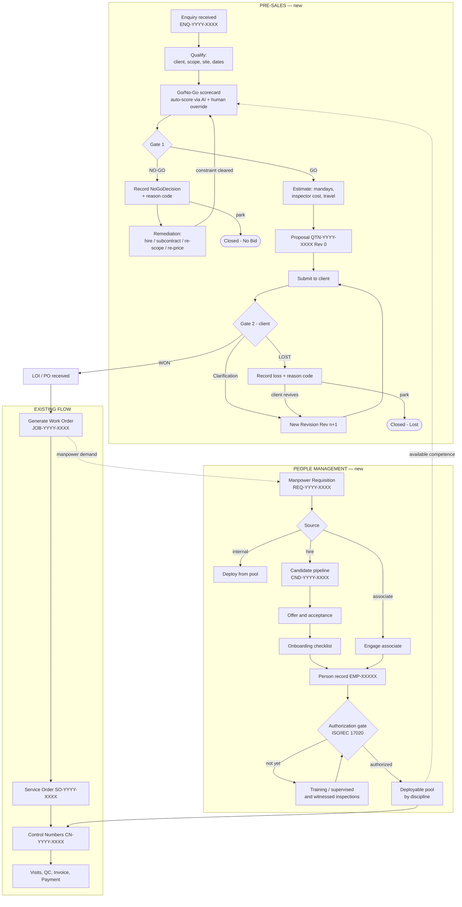

# IQE — People Management & Pre-Sales (Enquiry → Go/No-Go → Work Order) Specification

> Status: **Draft for review** · Author: design pass, Oct 2026
> Companion to `ARCHITECTURE_AND_E2E_FLOW.md` (which begins at Phase 1 = Job creation).
> This document specifies the two stages that sit *before* and *beside* that flow.

---

## 1. Why this document exists

The current system is complete from **Job creation → Visit → QC → Invoice → Payment**. Two
things are missing at either end of it:

| Gap | Today | Consequence |
| :--- | :--- | :--- |
| **Pre-sales** | `Enquiry` model exists (`modules/enquiries/`) but is an island: `status` is a free string defaulted to `"pending"`, there is no decision record, no proposal, no revision loop, and no path from enquiry into `Job`. | Won and lost work is invisible. Nobody can answer "why did we lose that one" or "what is in the pipeline". |
| **People** | A rich person master **exists in the legacy ASP.NET app** (`IQEApp.Web/Controllers/User/`, 121-property `UserViewModel`) but the FastAPI rewrite ported only `Competency`, `InspectorRate` and `Associate`. `auth.UserLogin` carries eight fields. | The migration silently dropped most of the people model — statutory, banking, qualification, secondment and empanelment data have no home in the new stack. Hiring, onboarding and authorization were never modelled in either stack. |

These two gaps are the same business loop seen from two ends: **work comes in → do we have
the people → if not, procure them**. They are specified together for that reason.

---

## 2. How the industry actually runs this

### 2.1 Pre-sales is a gated funnel, not a status field

Across EPC, TPI and engineering-services firms the pre-award pipeline is a sequence of
**gates**, each with an owner and an auditable decision:

```
RFQ / Enquiry received
   └─ Qualification      (is this real, is it ours?)
        └─ GATE 1: BID / NO-BID            ← internal decision
             └─ Estimation & pricing
                  └─ Proposal issued (Rev 0)
                       └─ Clarification / negotiation  → Rev 1, Rev 2 …
                            └─ GATE 2: AWARD / LOSS    ← client decision
                                 └─ LOI / PO → Work Order → Service Order
```

The single most important thing the current model misses: **there are two different "no"s,
and they are not interchangeable.**

| | **No-Go** | **Lost** |
| :--- | :--- | :--- |
| Who decided | We did | Client did |
| Gate | 1 | 2 |
| Typical reasons | Outside accreditation scope; no competent inspector in that geography; rate below floor; client credit risk; impartiality conflict; no capacity in window | Price; competitor awarded; project deferred/cancelled; technical non-compliance in our bid |
| Remedy loop | Fix the constraint (hire, subcontract, re-scope, re-price) then re-approach | Revise commercials/scope and resubmit, or park until client revives |

Krishna's description — *"they're gonna inquire about the non-go and they will check back
what are the issues was happened, they rebase the non-go stuff and again they recall for a
client request"* — is the remedy loop. Both paths feed it, but the remediation differs, so
both need a **reason code** and a **revision**, not a status flip.

### 2.2 Revisions are first-class

In tendering, a resubmission is never an edit — it is **Rev 0, Rev 1, Rev 2…**, each
immutable, each with its own price and date. This is how the client refers to it in
correspondence and how disputes get settled later. Overwriting a quotation in place is the
most common and most damaging modelling error in this domain.

### 2.3 Go/No-Go is scored, not toggled

Mature firms score the decision against weighted criteria rather than leaving it to a
yes/no click. It takes under a minute, produces a defensible record, and the accumulated
scores become the firm's best source of pricing and capability intelligence. It is also
the natural hook for the existing `modules/ai/` service to pre-score and recommend.

### 2.4 For an inspection body, HR *is* a compliance function

This is the part that makes IQE different from a generic company, and it should drive the
design.

ISO/IEC 17020 was revised and published **27 March 2026**, with a three-year transition
window for accredited bodies. Relevant to this module, the new edition emphasises:

- **"Access to" competent personnel** rather than strictly employed personnel — which
  legitimises the existing `Associate` (subcontracted inspector) model, provided competence
  is controlled the same way as for staff.
- **Enhanced monitoring** of personnel — periodic surveillance/witnessed inspections, not
  just a one-time qualification check.
- **Strengthened impartiality and independence** requirements.
- A **new section on control of data and information**, including software validation and
  security.

Sources: [UKAS ISO/IEC 17020 transition](https://www.ukas.com/accreditation/iso-iec-17020-transition/),
[UKAS technical bulletin, Mar 2026](https://www.ukas.com/wp-content/uploads/2026/03/2026.03.30-Technical-Bulletin-ISO-IEC-17020-2026-transition.pdf),
[European Accreditation announcement](https://european-accreditation.org/publication-of-the-new-international-standards-with-the-requirements-for-bodies-performing-inspection-and-certification-of-persons/).

> ⚠️ **Verify before building to it.** The above is from accreditation-body summaries, not
> the standard text. Clause numbering changed between editions — map every requirement in
> §6 below against the purchased copy of ISO/IEC 17020:2026 before treating it as a spec.
> The last commit on `main` claims alignment with this standard; that claim should be
> evidenced clause by clause.

**Design consequence:** *onboarded ≠ deployable*. A new inspector who has completed HR
onboarding must still pass an **authorization gate** — qualifications verified, training
completed, supervised/witnessed inspections logged, then formally authorized **for specific
inspection types**. Only then may the assignment engine offer them for those disciplines.
Generic HRMS products do not model this, and it is the single most valuable thing the IQE
people module can do.

---

## 3. Scope decision: build HR here, or integrate?

Worth settling before any code is written, because it changes the size of this module
considerably.

Split the problem in two:

| Layer | Recommendation |
| :--- | :--- |
| **Competence, authorization, deployability, assignment** | **Build natively in IQE.** It is operationally coupled to `jobs`, `visits` and `control_numbers`, it is accreditation evidence, and it has no meaning outside an inspection body. |
| **Generic HR admin** — payroll, leave, attendance, appraisal, exit | **Keep thin, or integrate.** This is commodity HRMS. Duplicating it inside IQE is a second product to maintain. |

Given Hyra (AI-first HRMS/ATS) exists in the same portfolio, the obvious question is whether
IQE's generic HR layer should be a Hyra tenant with IQE holding only the competence layer
and syncing a person record. That is an ownership and roadmap decision, not a technical one
— flagged here as **Open Decision 1** (§9), not assumed either way. The spec below is
written so the generic-HR tables can be dropped or swapped for an integration without
touching the competence model.

---

## 4. Target end-to-end flow



Two feedback edges matter and are easy to miss:

1. `JOB → REQ` — winning work *creates* manpower demand. Requisitions should be raisable
   directly from a won job, pre-filled with the disciplines and dates the job needs.
2. `DEPLOY → SCORE` — the go/no-go scorecard should **read** the deployable pool. "Do we
   have a Level II welding inspector free in Vizag that fortnight?" is a query, not a
   guess. This is what closes the loop between the two halves.

---

## 5. Part A — Pre-sales data model

### 5.1 Enquiry state machine

Replace the free-string `status` with an explicit enum. Transitions are recorded, never
silently overwritten.

```
DRAFT → QUALIFYING → PENDING_DECISION
                        ├── NO_GO ──────────► REMEDIATION ──► PENDING_DECISION  (loop)
                        │                           └──────► CLOSED_NO_BID
                        └── GO → ESTIMATING → PROPOSAL_DRAFT → SUBMITTED
                                                                  ├── UNDER_CLARIFICATION → SUBMITTED (new rev)
                                                                  ├── LOST ──► REVIVED → SUBMITTED (loop)
                                                                  │              └──► CLOSED_LOST
                                                                  └── WON → CONVERTED (job_id issued)
```

### 5.2 Models

Written in the existing Beanie/Pydantic house style (`modules/enquiries/models.py`).

```python
# modules/enquiries/models.py  — extends the existing file

class EnquiryStatus(str, Enum):
    DRAFT = "draft"; QUALIFYING = "qualifying"; PENDING_DECISION = "pending_decision"
    NO_GO = "no_go"; REMEDIATION = "remediation"; CLOSED_NO_BID = "closed_no_bid"
    GO = "go"; ESTIMATING = "estimating"; PROPOSAL_DRAFT = "proposal_draft"
    SUBMITTED = "submitted"; UNDER_CLARIFICATION = "under_clarification"
    LOST = "lost"; REVIVED = "revived"; CLOSED_LOST = "closed_lost"
    WON = "won"; CONVERTED = "converted"


class ScorecardCriterion(BaseModel):
    code: str                      # SCOPE_FIT, COMPETENCE, GEOGRAPHY, COMMERCIAL,
                                   # CLIENT_CREDIT, IMPARTIALITY, CAPACITY
    label: str
    weight: float = 1.0
    score: Optional[int] = None    # 0-5, null = not yet assessed
    auto_score: Optional[int] = None
    auto_rationale: Optional[str] = None   # from modules/ai
    remarks: Optional[str] = None


class GoNoGoDecision(Document):
    decision_id: str               # GNG-YYYY-XXXX
    enquiry_id: str
    site_id: str
    sequence: int = 1              # 2nd+ decision = post-remediation re-run
    criteria: list[ScorecardCriterion] = []
    weighted_score: float = 0.0
    recommendation: str            # go | no_go — system recommendation
    decision: str                  # go | no_go — human decision
    override_reason: Optional[str] = None   # REQUIRED when decision != recommendation
    reason_codes: list[str] = []            # required on no_go
    decided_by: str
    decided_at: datetime
    remediation_plan: Optional[str] = None
    remediation_owner: Optional[str] = None
    remediation_due: Optional[datetime] = None
    linked_requisition_id: Optional[str] = None   # if remedy = hire
    class Settings: name = "go_no_go_decisions"


class ProposalRevision(Document):
    proposal_id: str               # QTN-YYYY-XXXX
    revision_no: int               # 0, 1, 2 …  (immutable once issued)
    enquiry_id: str
    site_id: str
    status: str = "draft"          # draft | issued | superseded
    currency: str = "INR"
    line_items: list[EnquiryCategory] = []   # reuse existing shape
    estimated_mandays: float = 0.0
    inspector_cost: float = 0.0
    travel_cost: float = 0.0
    overhead_pct: float = 0.0
    margin_pct: float = 0.0
    total_value: float = 0.0
    validity_days: int = 30
    issued_at: Optional[datetime] = None
    issued_by: Optional[str] = None
    change_summary: Optional[str] = None     # why this revision exists
    document_id: Optional[str] = None        # generated PDF
    class Settings:
        name = "proposal_revisions"
        indexes = [("proposal_id", "revision_no")]   # unique
```

Fields to **add to the existing `Enquiry`**: `status` (enum above), `current_proposal_id`,
`current_revision_no`, `won_job_id`, `outcome_reason_codes`, `pipeline_value`,
`probability_pct`, `expected_award_date`, `source` (tender portal / direct / repeat /
referral), `competitor_names`, `status_history: list[StatusTransition]`.

### 5.3 Reason code master

Put this in `modules/masters/` so it is configurable rather than hard-coded. Reporting on
this taxonomy is the main commercial payoff of the whole pre-sales module.

| Group | Example codes |
| :--- | :--- |
| `NOGO_SCOPE` | outside accreditation scope · discipline not covered · unsafe/uninsurable |
| `NOGO_RESOURCE` | no competent inspector · none in geography · capacity clash |
| `NOGO_COMMERCIAL` | below rate floor · payment terms unacceptable · client credit risk |
| `NOGO_ETHICS` | impartiality conflict · prior design involvement |
| `LOST_PRICE` | undercut by competitor · client budget cut |
| `LOST_TECHNICAL` | spec non-compliance · certification not accepted |
| `LOST_TIMING` | project deferred · project cancelled · we responded late |
| `LOST_RELATIONSHIP` | incumbent retained · client policy |

### 5.4 ID standards to add

Extend the table in `ARCHITECTURE_AND_E2E_FLOW.md` §3.2:

| Entity | ID Schema | Parent |
| :--- | :--- | :--- |
| Enquiry | `ENQ-YYYY-XXXX` | Client |
| Go/No-Go Decision | `GNG-YYYY-XXXX` | Enquiry |
| Proposal | `QTN-YYYY-XXXX` (+ `Rev n`) | Enquiry |
| Manpower Requisition | `REQ-YYYY-XXXX` | Job *or* standalone |
| Candidate | `CND-YYYY-XXXX` | Requisition |
| Person / Employee | `EMP-XXXXX` | Site |
| Authorization | `ATH-YYYY-XXXX` | Person |

### 5.5 API surface

```
GET    /api/v1/enquiries                       ?status=&client_id=&from=&to=
POST   /api/v1/enquiries
GET    /api/v1/enquiries/{id}
PATCH  /api/v1/enquiries/{id}

POST   /api/v1/enquiries/{id}/scorecard        # create/refresh, calls AI auto-score
POST   /api/v1/enquiries/{id}/decision         # {decision, reason_codes[], override_reason}
POST   /api/v1/enquiries/{id}/remediate        # opens REMEDIATION, optional requisition
POST   /api/v1/enquiries/{id}/proposals        # creates Rev 0
POST   /api/v1/proposals/{pid}/revisions       # creates Rev n+1 (copy-on-write)
POST   /api/v1/proposals/{pid}/revisions/{n}/issue
POST   /api/v1/enquiries/{id}/outcome          # {won|lost, reason_codes[], award_ref}
POST   /api/v1/enquiries/{id}/convert          # → Job + ControlNumber; returns job_id
GET    /api/v1/pipeline/summary                # funnel counts + value by stage
GET    /api/v1/pipeline/loss-analysis          # reason-code rollup
```

`convert` is the join to the existing system: it creates the `Job`, seeds a `ControlNumber`
from the enquiry's `enquiry_no`/`enquiry_date` (fields `ControlNumber` already carries), and
sets `Enquiry.status = CONVERTED` with `won_job_id`.

---

## 6. Part B — People Management data model

### 6.0 What the legacy system already does

Source of truth for this section: `IQEApp.Web/Controllers/User/UserController.cs`,
`IQEApp.Web/Models/UserModel/UserViewModel.cs`, `IQEApp.Web/Views/User/*`. This is the
screen live at `/IQEIMSUAT/User/Index`.

**The `User/Index` screen today.** Admin-gated (`ScnFetMapId.MenuAdmin`), scoped to
`CurrentUser.SiteId`, renders `UserDetails.cshtml` → `_UserDirectory.cshtml` with columns:
Employee ID · Employee Name · Email · Contact No · Credentials · Discipline · Inspector
Code · City · Country · Cost/Hr · Mileage/Km · All Inclusive. Tabs: **Active · InActive ·
Secondment · Payroll**. Filters: user type, active flag, secondment flag, alpha search,
free search, country, sort order, paging.

**Concepts already present — do not reinvent these:**

| Legacy concept | Where | Maps to this spec |
| :--- | :--- | :--- |
| `UserTypeId` / `EmployeeTypeModel` master | `UserViewModel`, `UserDetailsModel` | `Person.category` (needs widening, see §6.1) |
| `IsSecondment` + its own directory tab | `UserController.UserList` | Deputation/assignment state |
| Empanelment (`IsEmpannlementflag`, `AddEmpannelment`) — Currency, Cost/Hr, Mileage/Km, All Inclusive | `_AddEmpannelment.cshtml` | `InspectorRate` / rate card |
| `CompentenceActive` + `UpdateCompetanceStatus(employeeCode, status, remarks)` | `UserController:970` | **Primitive authorization gate** — see §6.4 |
| CV documents with per-file validity dates | `CVDocumentViewModel`, `CVValidity`, `FileNameWithValidity` | Certificate expiry tracking |
| Statutory: ESI, PF, PA, Medical | `UserViewModel` | Must be carried forward |
| Banking: Bank A/c, IFSC, Branch, PAN, Aadhaar | `UserViewModel` | Must be carried forward |
| Master-linked Title / Country / State / Designation / SkillSet / Currency | `UserDetailsModel` lists | Keep as masters, not free text |
| `InspectorCode` ("Inspector Stamp No") distinct from `EmployeeCode` | `UserViewModel` | Two separate identifiers |
| Roles: SuperAdmin, Admin, Employee, Coordinator, QualityCheck, Finance | `CustomPrincipal.UserRoles` | Matches RBAC in `ARCHITECTURE_AND_E2E_FLOW.md` §6.2 |

**What is genuinely absent in both stacks:** manpower requisition, candidate/hiring
pipeline, onboarding checklist, impartiality declaration, supervised/witnessed inspection
log, structured employment lifecycle beyond an active boolean, and any non-inspector shape
to the record.

**The structural problem to fix.** `UserViewModel` is one class with 121 properties.
Inspector-specific fields — `InspectorCode`, `ProfQualification` (Discipline),
`CostPerHour`, `MilageInKm`, `AllInclusive`, `AssociateId` — sit on *every* user, including
an office boy. That is the concrete justification for the category-plus-profile split in
§6.1: it is not a preference, it is the existing model's failure mode.

### 6.1 Taxonomy: one person master, typed profiles

Krishna's list — *software developer, HR, office boy, technician, construction guy* — spans
wildly different attribute sets. The wrong answer is a table per type. The right answer, and
the standard HRMS pattern, is **one core `Person` + a category that selects which profile
extensions apply**.

```
Person (core: identity, contact, employment, documents, status)
   ├── category: TECHNICAL_INSPECTION   → + CompetenceProfile + Authorization + RateCard
   ├── category: TECHNICAL_ENGINEERING  → + SkillProfile (stack, tools, certifications)
   ├── category: SITE_LABOUR            → + TradeProfile (trade, skill grade, PPE, safety induction)
   ├── category: ADMIN_SUPPORT          → + (core only)
   └── category: CORPORATE_FUNCTION     → + (core only)
```

This is not a new axis — it is the existing `EmployeeTypeModel` master widened. Today its
values are inspector-shaped; the migration should extend the master rather than replace it,
and map every existing `UserTypeId` to a category during backfill.

Cross-cut this with **engagement type**, which is independent of category:

`PERMANENT` · `CONTRACT` · `ASSOCIATE` (subcontracted — the existing `Associate` model and
`AssociateId` link) · `SECONDMENT` (the existing `IsSecondment` flag, promoted from boolean
to a first-class value) · `DAILY_WAGE` · `TRAINEE` · `CONSULTANT`

Promoting `IsSecondment` matters: as a boolean it cannot express *to whom* and *for how
long* someone is seconded, which is precisely what a deputation needs to carry.

A construction worker is `SITE_LABOUR` + `DAILY_WAGE`; a retired NDT specialist is
`TECHNICAL_INSPECTION` + `ASSOCIATE`. Keeping the two axes separate avoids a combinatorial
mess of types and matches how payroll and compliance actually differ.

### 6.2 Models

```python
# modules/people/models.py  — new module

class Person(Document):
    person_id: str                 # EMP-XXXXX
    site_id: str
    user_id: Optional[str] = None  # link to auth.UserLogin if they log in
    employee_code: Optional[str] = None

    title_id: Optional[int] = None            # legacy UserTitle master
    full_name: str
    first_name: str
    last_name: Optional[str] = None
    date_of_birth: Optional[datetime] = None
    gender: Optional[str] = None
    phone: Optional[str] = None               # legacy EmpContactNumber
    email: Optional[str] = None
    emergency_contact_name: Optional[str] = None
    emergency_contact_phone: Optional[str] = None
    address: Optional[str] = None
    country_id: Optional[int] = None          # keep master-linked, not free text
    state_id: Optional[int] = None
    city_name: Optional[str] = None
    base_location: Optional[str] = None       # drives geography matching
    willing_to_travel: bool = True
    passport_no: Optional[str] = None         # overseas deputation
    passport_expiry: Optional[datetime] = None
    photo_document_id: Optional[str] = None

    # --- carried forward from legacy UserViewModel; do not drop in migration ---
    inspector_code: Optional[str] = None      # "Inspector Stamp No", distinct from employee_code
    designation_id: Optional[int] = None
    skill_set_ids: list[int] = []
    bank_account: Optional[str] = None
    ifsc_code: Optional[str] = None
    bank_branch: Optional[str] = None
    pan: Optional[str] = None
    aadhaar: Optional[str] = None
    esi_no: Optional[str] = None
    pf_no: Optional[str] = None
    pa_no: Optional[str] = None
    medical_ref: Optional[str] = None
    # --------------------------------------------------------------------------

    seconded_to_client_id: Optional[str] = None     # was IsSecondment (boolean)
    seconded_from: Optional[datetime] = None
    seconded_until: Optional[datetime] = None

    category: str                  # TECHNICAL_INSPECTION | TECHNICAL_ENGINEERING |
                                   # SITE_LABOUR | ADMIN_SUPPORT | CORPORATE_FUNCTION
    engagement_type: str           # PERMANENT | CONTRACT | ASSOCIATE | DAILY_WAGE | TRAINEE
    designation: str
    department: Optional[str] = None
    reports_to_person_id: Optional[str] = None
    date_of_joining: Optional[datetime] = None
    probation_end: Optional[datetime] = None
    contract_end: Optional[datetime] = None

    associate_id: Optional[str] = None        # if engagement_type == ASSOCIATE

    employment_status: str = "onboarding"     # onboarding | active | on_bench |
                                              # deployed | on_leave | suspended | exited
    deployable: bool = False                  # ← set ONLY by the authorization gate
    exit_date: Optional[datetime] = None
    exit_reason: Optional[str] = None

    documents: list[str] = []                 # document_id refs
    created_at: datetime = datetime.now()
    updated_at: datetime = datetime.now()
    class Settings:
        name = "people"
        indexes = ["site_id", "category", "employment_status", "deployable", "person_id"]


class Qualification(BaseModel):
    qualification_type: str        # DEGREE | CERTIFICATION | LICENCE | TRAINING
    name: str                      # "ASNT NDT Level II - UT", "CSWIP 3.1", "B.Tech Mech"
    issuing_body: Optional[str] = None
    certificate_no: Optional[str] = None
    issued_on: Optional[datetime] = None
    expires_on: Optional[datetime] = None      # drives expiry alerting
    verified: bool = False
    verified_by: Optional[str] = None
    verified_on: Optional[datetime] = None
    document_id: Optional[str] = None


class CompetenceProfile(Document):
    """Extends the existing users.Competency with evidence and currency."""
    profile_id: str
    person_id: str
    site_id: str
    competency_id: Optional[str] = None        # existing users.Competency doc
    qualifications: list[Qualification] = []
    years_experience: float = 0.0
    disciplines: list[str] = []                # welding, NDT-UT, electrical, civil …
    equipment_categories: list[str] = []       # mirrors users.Competency booleans
    languages: list[str] = []
    last_reviewed_on: Optional[datetime] = None
    next_review_due: Optional[datetime] = None
    class Settings: name = "competence_profiles"


class Authorization(Document):
    """ISO/IEC 17020 authorization: the gate between onboarded and deployable."""
    authorization_id: str          # ATH-YYYY-XXXX
    person_id: str
    site_id: str
    inspection_types: list[str]    # what they may sign off, specifically
    scope_limits: Optional[str] = None
    status: str = "pending"        # pending | authorized | suspended | withdrawn | expired
    qualification_verified: bool = False
    training_completed: bool = False
    supervised_inspections_count: int = 0
    supervised_required: int = 3
    witnessed_assessment_passed: bool = False
    witnessed_by: Optional[str] = None
    witnessed_on: Optional[datetime] = None
    authorized_by: Optional[str] = None        # technical manager
    authorized_on: Optional[datetime] = None
    valid_until: Optional[datetime] = None
    next_surveillance_due: Optional[datetime] = None   # ongoing monitoring
    suspension_reason: Optional[str] = None
    evidence_document_ids: list[str] = []
    class Settings:
        name = "authorizations"
        indexes = ["person_id", "status", "next_surveillance_due"]


class ImpartialityDeclaration(Document):
    """Strengthened in the 2026 edition; also a go/no-go scorecard input."""
    declaration_id: str
    person_id: str
    site_id: str
    declared_on: datetime
    conflicted_client_ids: list[str] = []
    conflicted_manufacturer_ids: list[str] = []
    prior_employment: Optional[str] = None
    notes: Optional[str] = None
    valid_until: Optional[datetime] = None
    class Settings: name = "impartiality_declarations"
```

### 6.3 Requisition & hiring ("HR procurement")

```python
class ManpowerRequisition(Document):
    requisition_id: str            # REQ-YYYY-XXXX
    site_id: str
    raised_by: str
    raised_on: datetime
    origin: str                    # JOB_DEMAND | REPLACEMENT | EXPANSION | NOGO_REMEDY
    job_id: Optional[str] = None           # when origin == JOB_DEMAND
    enquiry_id: Optional[str] = None       # when origin == NOGO_REMEDY
    category: str                  # same taxonomy as Person.category
    designation: str
    engagement_type: str
    headcount: int = 1
    required_disciplines: list[str] = []
    required_qualifications: list[str] = []
    min_experience_years: float = 0.0
    location: Optional[str] = None
    required_from: Optional[datetime] = None
    duration_months: Optional[float] = None
    budget_ctc_min: Optional[float] = None
    budget_ctc_max: Optional[float] = None
    justification: Optional[str] = None
    status: str = "draft"          # draft | pending_approval | approved | rejected |
                                   # sourcing | fulfilled | cancelled
    approvals: list[ApprovalStep] = []
    fulfilment_mode: Optional[str] = None  # INTERNAL_DEPLOY | ASSOCIATE | NEW_HIRE
    fulfilled_person_ids: list[str] = []
    class Settings: name = "manpower_requisitions"


class Candidate(Document):
    candidate_id: str              # CND-YYYY-XXXX
    requisition_id: str
    site_id: str
    full_name: str
    phone: Optional[str] = None; email: Optional[str] = None
    source: Optional[str] = None   # referral | portal | agency | walk-in | associate pool
    resume_document_id: Optional[str] = None
    claimed_qualifications: list[Qualification] = []
    stage: str = "applied"         # applied | screening | technical_interview |
                                   # client_approval | offer | offer_accepted |
                                   # onboarding | hired | rejected | withdrawn
    stage_history: list[StageTransition] = []
    rejection_reason_code: Optional[str] = None
    offered_ctc: Optional[float] = None
    expected_joining: Optional[datetime] = None
    converted_person_id: Optional[str] = None
    class Settings: name = "candidates"


class OnboardingTask(BaseModel):
    task_code: str                 # DOC_COLLECT, ID_CARD, PPE_ISSUE, SAFETY_INDUCTION,
                                   # QMS_TRAINING, EMAIL_SETUP, BANK_DETAILS, …
    label: str
    mandatory: bool = True
    applies_to_categories: list[str] = []      # drives the checklist per person type
    completed: bool = False
    completed_by: Optional[str] = None
    completed_on: Optional[datetime] = None
    document_id: Optional[str] = None
```

Note `client_approval` as a candidate stage — for TPI work the *client* frequently vets the
inspector CV before deployment. The `Job` model already has
`inspector_assignment_history` with `pending_client_approval`; the same mechanism applies
pre-hire for dedicated deputations, and the two should share a component.

The onboarding checklist is **category-driven**: `SITE_LABOUR` gets safety induction and
PPE issue; `TECHNICAL_INSPECTION` gets QMS training and impartiality declaration;
`ADMIN_SUPPORT` gets neither. Store task templates in `masters` so HR can edit them without
a deploy.

### 6.4 The authorization gate

**This formalises something that already exists.** The legacy app has
`UserController.UpdateCompetanceStatus(employeeCode, status, remarks)` writing a
`CompentenceActive` flag — someone already approves a person's competence, with remarks,
and the UI already has a Competence Details screen. What it lacks is: scope (authorized for
*which* inspection types), evidence (what was checked), expiry, surveillance, and any link
to whether the person can actually be assigned.

So this is not a new concept to sell internally — it is `CompentenceActive` given scope,
evidence and teeth. Migration should map existing `CompentenceActive = true` records to an
`Authorization` with `status = "authorized"` and a flag marking them **unverified legacy
grants**, to be re-evidenced at the next review rather than trusted silently.

The one piece of business logic worth stating explicitly:

```python
async def evaluate_deployability(person_id: str) -> bool:
    """Person.deployable is a DERIVED field. Never set it by hand."""
    auth = await Authorization.find_one(
        Authorization.person_id == person_id,
        Authorization.status == "authorized",
    )
    if not auth:
        return False
    now = datetime.now()
    if auth.valid_until and auth.valid_until < now:
        await _expire(auth); return False
    profile = await CompetenceProfile.find_one(CompetenceProfile.person_id == person_id)
    if profile and any(
        q.expires_on and q.expires_on < now
        for q in profile.qualifications
        if q.qualification_type in ("CERTIFICATION", "LICENCE")
    ):
        return False                      # lapsed cert ⇒ not deployable
    person = await Person.find_one(Person.person_id == person_id)
    return person.employment_status in ("active", "on_bench", "deployed")
```

Run it on: authorization change, qualification edit, employment-status change, and a nightly
sweep for expiries. Surface a **"certifications expiring in 60 days"** widget on the HR
dashboard — a lapsed inspector certificate discovered during an accreditation audit is a
finding; discovered 60 days early it is a calendar reminder.

### 6.5 Assignment integration

`modules/visits` and `Job.assigned_inspector_id` should select only from:

```
Person.deployable == True
  AND category == TECHNICAL_INSPECTION
  AND authorization.inspection_types ⊇ required type
  AND no impartiality conflict with job.client_id / job.manufacturer_id
  AND no calendar clash in the visit window
  AND base_location within range, or willing_to_travel
```

Today `Job.assigned_inspector_id` is a free string with no such constraint. Closing that is
the highest-value single change in this spec: it converts the people module from a record
store into a control.

### 6.6 API surface

```
GET/POST   /api/v1/people                      ?category=&status=&deployable=&discipline=
GET/PATCH  /api/v1/people/{person_id}
POST       /api/v1/people/{person_id}/qualifications
POST       /api/v1/people/{person_id}/authorizations
PATCH      /api/v1/authorizations/{id}         # authorize | suspend | withdraw
POST       /api/v1/people/{person_id}/impartiality
GET        /api/v1/people/deployable           # the assignment pool query (§6.5)
GET        /api/v1/people/expiring             ?days=60

GET/POST   /api/v1/requisitions
POST       /api/v1/requisitions/{id}/approve
POST       /api/v1/requisitions/{id}/fulfil    # {mode, person_ids[]}
GET/POST   /api/v1/requisitions/{id}/candidates
PATCH      /api/v1/candidates/{id}/stage
POST       /api/v1/candidates/{id}/convert     # → Person + onboarding checklist
GET        /api/v1/onboarding/{person_id}
PATCH      /api/v1/onboarding/{person_id}/tasks/{task_code}
```

---

## 7. Frontend routes to add

Following the existing `apps/web/src/app/` convention:

```
enquiries/            list + funnel board (kanban by stage)
enquiries/[id]/       detail: scorecard, decisions, revisions timeline
proposals/[id]/       revision comparison view
pipeline/             funnel dashboard, win-rate, loss analysis by reason code
people/               directory, filter by category / deployable / discipline
people/[id]/          profile: competence, authorizations, documents, history
people/authorizations/  technical manager's authorization queue
requisitions/         list + approval queue
requisitions/[id]/    candidate pipeline board
onboarding/           active onboarding checklists
```

The existing `proposed-assignments/` route already hints at the assignment UI; it should be
rewired to the deployable-pool query rather than a free inspector list.

---

## 8. Suggested build order

Each phase is independently shippable and useful on its own.

| Phase | Scope | Why this order |
| :--- | :--- | :--- |
| **1** | `Person` master + category/engagement taxonomy + directory UI. **Migrate from the legacy SQL user tables, not from `auth.UserLogin`** — the legacy model holds the statutory, banking, qualification, secondment and empanelment data the FastAPI rewrite dropped. Reproduce the four existing directory tabs (Active / InActive / Secondment / Payroll) so the screen is not a regression for current users. | Everything else references a person. No dependencies. |
| **2** | `CompetenceProfile` + `Authorization` + deployability derivation + expiry alerts. Migrate `users.Competency`, legacy `CompentenceActive` (flagged as unverified legacy grants, §6.4), and CV validity dates. | Delivers the accreditation evidence; standalone value even before hiring exists. |
| **3** | Rewire assignment (`jobs`, `visits`, `proposed-assignments`) to the deployable pool. | Converts phase 2 from records into control. Small change, large effect. |
| **4** | Enquiry state machine + `GoNoGoDecision` + reason-code master + pipeline dashboard. | Pure addition; the enquiry model already exists and is barely used. |
| **5** | `ProposalRevision` + revision loop + `convert` → Job. | Completes pre-sales; needs phase 4's states. |
| **6** | `ManpowerRequisition` + `Candidate` + onboarding checklists. | Needs phase 1 (person) and benefits from phase 5 (job-driven demand). |
| **7** | AI auto-scoring on the go/no-go scorecard via `modules/ai`; capacity lookahead from the deployable pool. | Needs real scorecard history to be worth anything. Do not start here. |

Phases 1–3 are the compliance-critical path given the ISO/IEC 17020:2026 transition window.
Phases 4–5 are the commercial path. They can run in parallel by different people; they only
meet at phase 6.

---

## 9. Open decisions — need Krishna's call

1. **HR scope.** Build generic HR (payroll/leave/attendance) inside IQE, or keep IQE to the
   competence layer and integrate Hyra for the rest? Changes phase 6 substantially. (§3)
2. **Does the Job ID get issued at Go, or at Win?** This spec says **at Win** — enquiries
   carry `ENQ-` until awarded, keeping `jobs` free of speculative records. Krishna's
   description ("once if it is in a go, then a unique ID would be generated") may mean at
   Go. If so, Job needs a `pipeline` status and all job reporting needs a won/pipeline
   filter. Worth settling before phase 5.
3. **"Work order" = Job, or a separate entity?** Treated here as a synonym for the existing
   `Job` umbrella. If the client-facing work order is a distinct document from the internal
   job container, it needs its own ID series and model.
4. **Go/No-Go approval authority.** Who can decide, and does value threshold change it
   (e.g. > ₹10L needs MD)? Drives the `approvals` chain on the decision record.
5. **Associate parity.** Do subcontracted associates go through the same authorization gate
   as employees? Under the "access to competent personnel" framing they should, but it
   changes the associate onboarding effort.
6. **Site labour in scope?** `SITE_LABOUR`/`DAILY_WAGE` implies attendance and wage
   computation, which is a different build from salaried staff. Include now or defer?
7. **What is the "Payroll" tab on `User/Index` today?** It appears alongside Active /
   InActive / Secondment but its behaviour was not traced in this pass. If it drives actual
   payroll output, that changes Open Decision 1 materially — IQE would already own payroll
   data rather than being free to delegate it.
8. **Legacy data quality.** `UserController` carries `CreateUser1`, `UpdateUser1`,
   `UpdateUser12`, `_EditUser - Copy.cshtml`, `_UserDirectory - Copy (2).cshtml` and similar
   duplicates. Before migrating, someone should confirm which write path production
   actually uses, or the backfill will replicate whichever variant was abandoned.

---

## 10. Sources and verification note

§6.0 was derived by reading the legacy ASP.NET source in this repository, **not** by
viewing the running UAT site at `/IQEIMSUAT/User/Index` — that was not reachable during
this pass. Rendered behaviour (JS-driven fields, conditional sections, actual master
values in the `EmployeeType` and `Designation` tables) should be confirmed against the live
screen before migration mapping is finalised. Anything in §6.0 marked as a column or tab
comes from the `.cshtml` markup and is reliable; anything about *data* is inference from
model shape.


The ISO/IEC 17020:2026 points in §2.4 come from accreditation-body summaries, not the
standard text, and clause numbering changed between editions. Before phase 2 is built,
someone with the purchased standard should map each requirement in §6 to its clause. The
existing commit message on `main` asserts alignment with ISO 9001:2026 and
ISO/IEC 17020:2026 — that assertion is currently unevidenced in the repository and should
either be substantiated with a compliance matrix or softened.
