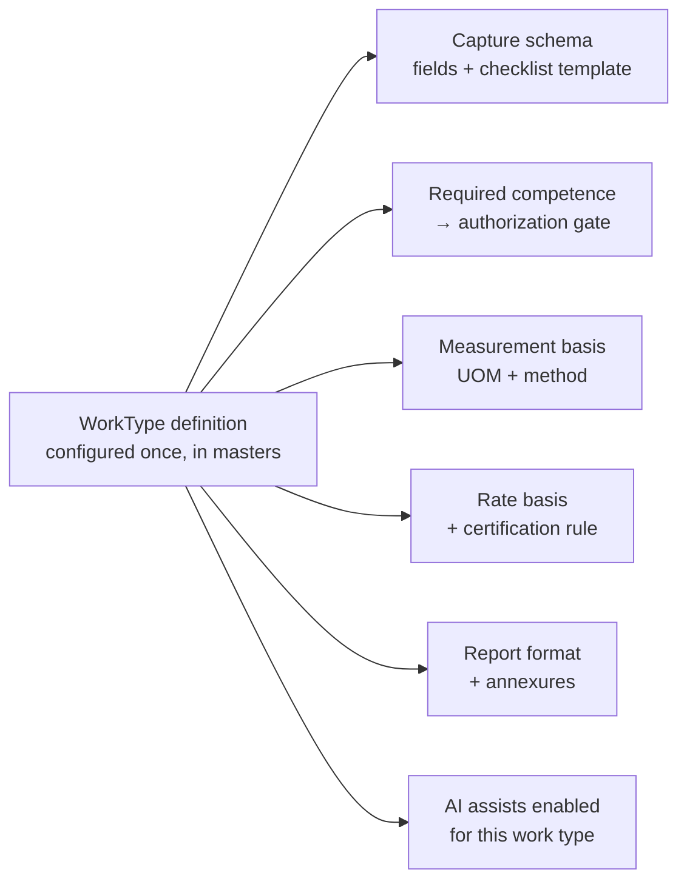
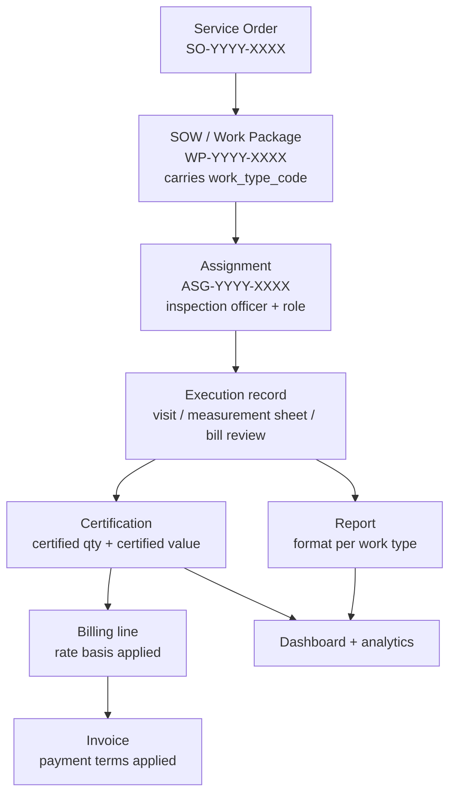

# IQE — SOW Execution Architecture
## Work packages → inspection officer assignment → measurement → certification → billing → reporting → dashboard

> Status: **Draft for review** · Oct 2026
> Third document in the set. Companions: `ARCHITECTURE_AND_E2E_FLOW.md` (existing pipeline),
> `PEOPLE_AND_PRESALES_SPEC.md` (pre-sales gate + people/competence).
> This one covers what happens **between** a Service Order and an Invoice.

---

## 1. The finding that shapes everything below

The platform already does this work. It does it **three separate times, in three
hardcoded verticals that share no spine**:

| Module | What it does | How it is built |
| :--- | :--- | :--- |
| `modules/tpi/` | TPI inspection reports, photos, signatures | Own models, own PDF path |
| `modules/schedule_m_pharma_epc/` | A complete pharma-EPC vertical: checklists, requirements register, RFI, URS traceability, red flags, **quantity measurement, BOQ reconciliation, RA-bill review**, NCR/CAPA, punch items, calibration, turnover dossier | Own models, 20+ bespoke routes, project name hardcoded in defaults |
| `modules/construction_bill_verification/` | Civil bill verification: material ledgers, steel diameter ledgers, waybills, wastage %, claimed vs verified payable | Own models, own report ref format |

Each re-implements the same five concepts under different names — a work item, a
measurement, a verification result, a certified value, a report. `ScheduleMBOQReconciliation`
and `ConstructionAbstractItem` are the same idea with different field names.

So the request — *"it might be bill verification, it might be BOQ, or it might be anything
as per code"* — is not asking for a fourth vertical. It is asking for **the abstraction those
three should have been built on**. That abstraction is this document.

The cost of not doing it: every new client type (your uploaded `Megafine.6` schedule is a
pharma EPC build — LOI 04/04, PO 08/04, civil → PEB → HVAC → piping → electrical → equipment
erection → IQ/OQ/PQ → handover) means another hardcoded module, another report format,
another dashboard query, and no cross-project reporting.

---

## 2. The central abstraction: `WorkType` drives everything

One configurable definition decides, for a given piece of work, **what gets captured, who may
do it, how it is measured, how it bills, and what report comes out.**



Adding a work type becomes configuration plus a report template, not a module.

### 2.1 Work type catalogue

Derived from what the platform already does, plus the uploaded project schedule:

| Code | Work type | Measured in | Bills on | Existing code to fold in |
| :--- | :--- | :--- | :--- | :--- |
| `CODE_INSP` | Code-based inspection (ASME / IS / API / EN) | Visits, hold points | Per visit / man-day | `modules/tpi` |
| `BOQ_RECON` | BOQ reconciliation & quantity survey | Quantity × unit | % of certified value, or per unit | `schedule_m_pharma_epc` measurements + BOQ recon |
| `BILL_VERIF` | RA / running bill verification | Bills reviewed, certified value | % of certified value, or lump sum | `construction_bill_verification`, `ra-bill-review` |
| `GMP_SCHEDM` | Schedule M / WHO-GMP compliance | Checklist items, disciplines | Lump sum per phase | `schedule_m_pharma_epc` checklists |
| `VENDOR_AUDIT` | Vendor capability assessment | Audits | Per audit (lump sum) | — |
| `EXPEDITING` | Expediting & progress monitoring | Visits / reports | Per visit or monthly retainer | — |
| `SAT_COMM` | Site acceptance & commissioning tests | Equipment units | Per unit / man-day | — |
| `STAFF_DEPUT` | Site deputation / secondment | Man-days deployed | Monthly man-day rate | Links to `Person.engagement_type` |

> The point of the table is that the **last two columns differ per row** — which is exactly
> why measurement and billing cannot stay hardcoded inside each vertical.

### 2.2 Model

```python
# modules/work_types/models.py — new, lives in masters

class WorkTypeDefinition(Document):
    work_type_code: str                  # CODE_INSP, BOQ_RECON, BILL_VERIF …
    site_id: str
    name: str
    description: Optional[str] = None
    discipline_tags: list[str] = []

    # --- what governs it ---
    applicable_codes: list[str] = []     # ASME SEC VIII, IS 456, Schedule M, WHO-GMP
    acceptance_basis: Optional[str] = None

    # --- who may perform it (hard gate, see §5) ---
    required_authorization_types: list[str] = []
    required_qualifications: list[str] = []
    min_experience_years: float = 0.0

    # --- how it is captured ---
    capture_schema_id: Optional[str] = None     # field set for the mobile/web form
    checklist_template_id: Optional[str] = None
    requires_photos: bool = True
    requires_measurements: bool = False

    # --- how it is measured ---
    measurement_uom: Optional[str] = None       # cum, sqm, MT, nos, visit, man-day
    measurement_method: Optional[str] = None    # joint measurement, record review, witness

    # --- how it bills (see §4) ---
    default_rate_basis: str = "PER_VISIT"
    certification_required_before_billing: bool = True

    # --- what comes out ---
    report_format_code: Optional[str] = None    # see §6
    annexure_format_codes: list[str] = []

    # --- AI assists permitted for this work type (see §7) ---
    ai_assists: list[str] = []           # DOC_EXTRACT, CHECKLIST_GEN, REPORT_DRAFT,
                                         # VALIDATION, PHOTO_TAG, ANOMALY
    is_active: bool = True
    class Settings: name = "work_type_definitions"
```

---

## 3. The SOW spine

Today `Job.scope_of_work` is `list[SOWItem]` — an embedded checklist with `item_id`,
`description`, `category`, `completed`. That is too thin to hang assignment, measurement and
billing off. It needs to become a document in its own right: a **work package**.



### 3.1 Work package

```python
class WorkPackage(Document):
    work_package_id: str                 # WP-YYYY-XXXX
    site_id: str
    job_id: str
    so_id: Optional[str] = None
    control_number_id: Optional[str] = None
    parent_package_id: Optional[str] = None     # supports WBS nesting

    work_type_code: str                  # ← drives everything downstream
    title: str
    description: Optional[str] = None
    discipline: Optional[str] = None

    # location & counterparty
    client_id: Optional[str] = None
    manufacturer_id: Optional[str] = None
    location: Optional[str] = None

    # planning — maps to an imported MS Project / P6 schedule
    planned_start: Optional[datetime] = None
    planned_finish: Optional[datetime] = None
    predecessor_package_ids: list[str] = []     # from Predecessors column
    external_schedule_ref: Optional[str] = None # e.g. "Megafine.6 task 85"
    planned_quantity: float = 0.0
    planned_uom: Optional[str] = None
    planned_effort_mandays: float = 0.0

    # commercial
    rate_basis: Optional[str] = None     # inherits WorkTypeDefinition, overridable
    rate: float = 0.0
    currency: str = "INR"
    ceiling_value: Optional[float] = None

    status: str = "planned"              # planned | assigned | in_progress |
                                         # submitted | under_qc | certified |
                                         # billed | closed | on_hold
    percent_complete: float = 0.0
    class Settings:
        name = "work_packages"
        indexes = ["job_id", "work_type_code", "status", "planned_start"]
```

The `predecessor_package_ids` and `external_schedule_ref` fields matter: the uploaded
`Megafine.6` file is a Microsoft Project export with explicit predecessors
(`2SS+12 days`, `60FS+4 days`). Client EPC schedules arrive in this form routinely. **Importing
them and hanging work packages off their task IDs is what makes inspection planning
predictive rather than reactive** — you know on 13/08 that equipment erection starts and
therefore a mechanical inspector is needed at that site in that window.

### 3.2 Assignment — the "inspection officer" record

One work package can carry several people in different roles. Model it as its own document,
not a field on the package.

```python
class Assignment(Document):
    assignment_id: str                   # ASG-YYYY-XXXX
    site_id: str
    work_package_id: str
    job_id: str
    person_id: str                       # → Person (PEOPLE_AND_PRESALES_SPEC §6)

    role: str                            # INSPECTION_OFFICER | LEAD_INSPECTOR |
                                         # QUANTITY_SURVEYOR | BILL_VERIFIER |
                                         # QC_REVIEWER | WITNESS | TRAINEE_UNDER_SUPERVISION
    is_primary: bool = True
    supervised_by_person_id: Optional[str] = None   # required when role = TRAINEE_*

    # assignment provenance — how this person got here
    assigned_by: Optional[str] = None
    assignment_method: str = "manual"    # manual | ai_recommended | ai_auto
    ai_score: Optional[float] = None
    ai_rationale: Optional[str] = None
    alternatives_considered: list[dict] = []        # audit trail of who else scored

    # gating evidence captured AT ASSIGNMENT TIME, not derived later
    authorization_id: Optional[str] = None
    authorization_valid_until: Optional[datetime] = None
    impartiality_checked: bool = False
    impartiality_conflict_found: bool = False

    planned_from: Optional[datetime] = None
    planned_to: Optional[datetime] = None
    status: str = "proposed"             # proposed | pending_client_approval |
                                         # accepted | rejected | active | completed | withdrawn
    client_approval_required: bool = False
    client_approved_at: Optional[datetime] = None
    class Settings:
        name = "assignments"
        indexes = ["work_package_id", "person_id", "status", "planned_from"]
```

**Why the gating evidence is snapshotted.** A certificate that was valid on the inspection
date but has since expired must still show the inspection was validly performed. Deriving
authorization live would make historical records lie after the certificate lapses. This is
an accreditation-audit requirement, not a nicety.

---

## 4. Billing architecture

The request named these explicitly: *"payment type hour or package, pay cycle 30 or 60"*.
Today `Invoice.billing_type` is `"hourly"` or `"bulk"` — two values for a domain that has at
least six.

### 4.1 Rate basis

| Code | Charged on | Typical work type |
| :--- | :--- | :--- |
| `HOURLY` | Verified hours | Ad-hoc technical support |
| `MAN_DAY` | Days deployed | Site deputation, overseas assignment |
| `PER_VISIT` | Visits performed | Vendor inspection, expediting |
| `PER_UNIT` | Units measured × rate | SAT (per crane), equipment inspection |
| `LUMP_SUM` | Fixed package price, milestone-released | GMP compliance, audit packages |
| `PCT_CERTIFIED_VALUE` | % of value certified | **BOQ reconciliation, bill verification** |
| `RETAINER` | Fixed monthly | Long-running site presence |

The BOQ case the request singled out is `PCT_CERTIFIED_VALUE` or `PER_UNIT`: measurement
produces a certified quantity, the certified quantity produces a certified value, and the fee
is a function of that value. **Billing is therefore downstream of certification and cannot be
computed before QC sign-off** — which is why `certification_required_before_billing` sits on
the work type.

### 4.2 Certification — the missing link

```python
class Certification(Document):
    certification_id: str                # CERT-YYYY-XXXX
    work_package_id: str
    job_id: str; site_id: str
    certified_by_person_id: str
    certified_at: datetime

    claimed_quantity: float = 0.0        # what the contractor claimed
    certified_quantity: float = 0.0      # what IQE verified
    rejected_quantity: float = 0.0
    uom: Optional[str] = None
    rate: float = 0.0
    claimed_value: float = 0.0
    certified_value: float = 0.0         # ← the number billing keys off
    deduction_value: float = 0.0
    deduction_reasons: list[str] = []

    measurement_sheet_refs: list[str] = []
    ncr_ids: list[str] = []
    evidence_document_ids: list[str] = []
    status: str = "draft"                # draft | issued | disputed | revised | superseded
    revision_no: int = 0                 # certifications get revised; keep history
    class Settings: name = "certifications"
```

`claimed vs certified vs deduction` already exists in both `ConstructionAbstractItem`
(`claimed_amount` / `verified_payable_amount`) and `ScheduleMRABillReview`
(`claimed_qty` / `verified_qty`). This unifies them.

### 4.3 Payment terms

Add to `ServiceOrder` (contract level), inherited by invoices:

```python
payment_terms_code: str = "NET_30"   # NET_15 | NET_30 | NET_45 | NET_60 | NET_90 |
                                     # ON_CERTIFICATION | MILESTONE | ADVANCE_PCT
billing_frequency: str = "PER_MILESTONE"   # PER_VISIT | WEEKLY | FORTNIGHTLY |
                                           # MONTHLY | PER_MILESTONE | ON_COMPLETION
retention_pct: float = 0.0           # EPC contracts commonly retain 5–10%
advance_pct: float = 0.0
```

`Invoice.due_date` then derives from `invoice_date + payment_terms`, and `overdue_alert`
(already on the model) becomes computable rather than manual. Retention matters on EPC work
and has no home today — without it, certified value and invoiced value will never reconcile.

---

## 5. The AI roster / auto-assignment engine

The TÜV India deck you shared proposes auto-assignment weighted as: Skill 40%, Location 25%,
Availability 20%, Workload 10%, Past performance 5%.

**Adopt the scoring, but not the shape.** For an accredited inspection body, competence is not
a weighted factor that can be traded off against convenience — it is a precondition. A
nearby, available, lightly-loaded inspector who is not authorized for that inspection type
must score *zero*, not 60%. Weighted-sum scoring alone can and will surface that person.

So the engine is **two-stage: hard filter, then soft score.**

```python
async def recommend_officers(work_package_id: str, top_n: int = 5) -> list[dict]:
    wp = await WorkPackage.get_by_id(work_package_id)
    wt = await WorkTypeDefinition.find_one(
        WorkTypeDefinition.work_type_code == wp.work_type_code)

    # ---------- STAGE 1: HARD GATE (non-negotiable, no weighting) ----------
    pool = await Person.find(
        Person.site_id == wp.site_id,
        Person.deployable == True,              # derived from authorization gate
    ).to_list()

    eligible = []
    for p in pool:
        auth = await current_authorization(p.person_id)
        if not auth:                                    continue
        if not set(wt.required_authorization_types) <= set(auth.inspection_types):
            continue
        if auth.valid_until and auth.valid_until < wp.planned_start:
            continue                                    # cert lapses before the work
        if await has_impartiality_conflict(p.person_id, wp.client_id, wp.manufacturer_id):
            continue                                    # ISO/IEC 17020 independence
        if await has_calendar_clash(p.person_id, wp.planned_start, wp.planned_finish):
            continue
        eligible.append((p, auth))

    # ---------- STAGE 2: SOFT SCORE (ranking only) ----------
    scored = []
    for p, auth in eligible:
        s = (
            0.40 * skill_depth_score(p, wt)             # beyond the minimum bar
          + 0.25 * proximity_score(p, wp.location)
          + 0.20 * availability_headroom(p, wp)
          + 0.10 * workload_balance(p)
          + 0.05 * past_performance(p, wt.work_type_code)
        )
        scored.append({
            "person_id": p.person_id, "score": round(s, 3),
            "rationale": explain(p, wt, wp),            # every score is explainable
            "authorization_id": auth.authorization_id,
        })
    return sorted(scored, key=lambda x: -x["score"])[:top_n]
```

**Recommend by default, auto-assign only where configured.** Give `WorkTypeDefinition` an
`auto_assign_threshold`: auto-assign when the top score clears it and the margin over second
place is material; otherwise present a ranked shortlist to the coordinator. Record which
happened in `Assignment.assignment_method` — an accreditation auditor will ask whether a
machine assigned the inspector, and "the system chose, here is the rationale and who else was
considered" is a defensible answer. "The system chose" alone is not.

**Roster view.** The same engine backs a calendar roster: people down the side, dates across,
work packages as blocks, with unassigned packages in a side rail to drag in. Conflicts,
certificate expiries falling inside an assignment window, and over-allocation surface as
badges on the block.

---

## 6. Reporting architecture

Every vertical currently owns its report path. Replace with a **format registry** keyed by
work type:

```python
class ReportFormat(Document):
    format_code: str              # IVR, FIR, IRN, EVR, LOGSHEET, RA_BILL_CERT,
                                  # BOQ_RECON, MEASUREMENT_SHEET, NCR, PUNCH_LIST,
                                  # TURNOVER_DOSSIER, SAT_CERT
    name: str
    work_type_codes: list[str] = []
    template_path: str            # backend/app/pdf/templates/…
    sections: list[str] = []
    requires_signatures: list[str] = []     # inspector, QC reviewer, client witness
    annexures: list[str] = []
    is_client_specific: bool = False
    client_id: Optional[str] = None         # clients demand their own layouts
    revision: str = "Rev 0"
```

The web app already has routes for most of these: `inspection-visit-report`,
`flash-inspection-report`, `expediting-visit-report`, `inspection-release-note`, `logsheet`,
`itps`, `pms-formats`, `sops`, `work-instructions`. They should become one renderer driven by
`format_code`, not nine screens.

**End-to-end project report** — the request asked for this. It is a composition, not a new
document type: project header → work packages by discipline and status → certified quantities
and values vs BOQ → NCRs open/closed by severity → punch list status → inspector man-days
consumed → photographic annexure → billing and payment position. Generated per job, exportable
to PDF, and driven entirely by the spine above.

### Built (phase 6)

`backend/modules/reporting/` implements the registry and the composed report:
`GET /reporting/formats`, `POST /reporting/formats/seed` (idempotent per site),
`GET /reporting/formats/for-work-type/{code}`, `GET /reporting/project-report/{job_id}`.
Twelve formats ship in `DEFAULT_FORMATS`, covering every work type in the catalogue — a test
asserts that, so a new work type without a report format fails the suite rather than reaching
a client with nothing to hand over. `/reports` in the web app browses the registry and composes
the project report on demand.

**What was deliberately not done:** the nine existing report screens were *not* collapsed into
the single renderer described above. They work today, and rewriting them without being able to
render them against real data would risk breaking live deliverables to gain structure. The
registry is the home for new formats and for the composed report, which had none; folding the
nine in is a follow-up to do screen by screen with a visible comparison each time.

**The registry now drives the renderer.** `app/pdf/formats.py` resolves a format to a render
spec in one place: a client's own variant, then the registry, then the legacy configs, then a
generic renderer. Rendering stays synchronous — the registry is pushed in at startup by
`ReportingService.sync_renderer()`, and `POST /reporting/sync-renderer` refreshes it without a
restart. Nothing breaks if that never runs, because the legacy configs remain the base layer.

All thirteen formats render. `templates/generic.html` builds a document from whatever sections a
format declares, which is what gives the six formats that never had a template a PDF without
writing six bespoke files; `templates/project_report.html` gives the composed report its own
layout. `GET /reporting/formats/{code}/pdf` returns a blank pro forma and
`GET /reporting/project-report/{job_id}/pdf` the composed report, both on IQE letterhead with
the brand watermark.

Historical note, kept because it explains the shape of the fix:
`app/pdf/service.py` keeps its own hardcoded `FORM_CONFIGS` table keyed on the legacy form codes
(`TP02`, `FBILL01`, `FBOQ01`…), while the registry is keyed on report codes (`IVR`, `FIR`,
`RA_BILL_CERT`…). Both describe the same seven templates, so the mapping now lives in two places
that can disagree — and did. Five of the thirteen registry formats have a template; the other
eight (`LOGSHEET`, `MEASUREMENT_SHEET`, `GMP_COMPLIANCE`, `SAT_CERT`, `VENDOR_AUDIT`,
`PROJECT_REPORT`) have no PDF at all. The project report is JSON plus a browser print; there is
no server-side PDF of it.

Closing this means making `FORM_CONFIGS` read from `ReportFormat` rather than its own table, and
authoring the eight missing templates. Until then, three tests guard the seam
(`tests/test_reporting.py`): every `template_path` must exist on disk, no two formats may share a
template, and a format's name must share vocabulary with the title the template itself declares.
That last test exists because of a real defect: `GMP_COMPLIANCE` ("Schedule M Compliance Report")
was pointed at `fqual01.html`, which declares itself "Quantity Verification & Survey Report". The
file existed and nothing else used it, so only comparing the two titles caught it. The same
exercise revealed that `fqual01` is a real IQE form (F-QUAL-01) the registry had omitted
entirely, now entered as `QTY_SURVEY`.

---

## 7. AI capability map

The deck you shared lists eight use cases (scheduling, email bot, auto-assignment, inspector
notifications, report generation, report validation, dynamic checklists, CRM). Mapped against
what this platform already has:

| UC | Where it lands here | Readiness |
| :--- | :--- | :--- |
| Inspection scheduling | §5 engine + work package planned dates | **Buildable now** — data model exists |
| Inspector auto-assignment | §5, two-stage | **Buildable now** |
| Inspector notifications & history | Assignment + prior visits/NCRs at same site | Easy; needs notification channel |
| Report generation | §6 renderer + captured field data | **Highest ROI** — biggest manual cost today |
| Report validation | Pre-submission checks against the capture schema | Buildable now |
| Dynamic checklists | `checklist_template_id` generated per work type + scope | Needs the §2 abstraction first |
| Email/document intake | `modules/ai` + `file_upload`; extract enquiry and MTC data | Needs IDP pipeline |
| CRM / lead management | Covered by `PEOPLE_AND_PRESALES_SPEC` §5 pipeline | Spec'd, not built |

Two additions specific to this platform that the deck does not cover:

- **Quantity/BOQ anomaly detection.** Claimed vs certified quantities across RA bills, with
  outlier flagging on wastage %, sudden rate changes, and quantities exceeding revised BOQ.
  `construction_bill_verification` already computes wastage and `ScheduleMRedFlagCheck`
  already exists — this is the AI layer those were built for.
- **Schedule-driven demand forecasting.** Parse client MS Project/P6 files (your `Megafine.6`
  upload) and project inspector demand by discipline and week. Feeds the requisition flow in
  `PEOPLE_AND_PRESALES_SPEC` §6.3.

### Honesty note on the benchmarking numbers

The deck's figures — assignment errors "~20% → under 2%", confirmation "30 minutes instead of
24–48 hours", Bureau Veritas "8000+ documents and 1200 pressure vessels" — are **TÜV India's
own projections and claims for their context, not measured outcomes**. I checked the publicly
documented Bureau Veritas work: their published IDP case study with super.AI is about
extracting asset data from **equipment nameplate photographs**, and reports vendor-supplied
figures (75% processing-time reduction, 80% data-entry cost saving); it does not mention
document or pressure-vessel volumes.
Sources: [super.AI case study](https://www.super.ai/case-studies/bureau-veritas),
[BV independent AI assessment offering with AWS, Apr 2026](https://www.businesswire.com/news/home/20260401410180/en/Bureau-Veritas-Launches-an-Independent-AI-Assessment-Offering-for-European-Enterprises-Developed-in-Partnership-with-Amazon-Web-Services-AWS),
[BV targeting €1bn from AI-driven markets by 2030](https://container-news.com/bureau-veritas-targets-e1-billion-revenue-from-ai-driven-markets-by-2030/).

Use the deck's use-case *list* as a roadmap — it is a sound one. Do not carry its *numbers*
into an IQE business case as evidence; set your own baselines first (current assignment error
rate, current report turnaround) so improvement is measurable rather than asserted.

**One strategic note worth separating from the operational roadmap:** Bureau Veritas is not
only using AI internally, it is now *selling AI assurance* — an independent AI assessment
offering, with a stated €1bn revenue ambition from AI-driven markets by 2030. For an
inspection body, "we certify AI systems" is a service line, not just an efficiency
programme. Out of scope for this architecture, but it belongs on the strategy agenda.

---

## 8. Dashboard architecture

One dashboard per role, all reading the same spine — not per-module dashboards.

| Role | Answers |
| :--- | :--- |
| **Coordinator** | Unassigned work packages, today's roster, conflicts, certificate expiries this month, client approvals pending |
| **Inspection Officer** | My assignments this week, site context and prior NCRs, forms due, expenses pending |
| **QC Reviewer** | Submitted awaiting review, aged >48h, NCRs by severity, reports failing validation |
| **Finance** | Certified but unbilled value, invoices by ageing bucket, retention held, overdue >60 days |
| **Technical Manager** | Authorizations expiring, surveillance due, competence coverage gaps by discipline |
| **Management** | Pipeline (from pre-sales spec), revenue by work type, inspector utilisation, win/loss, project heat map |

The number that should be on the management dashboard and currently cannot be computed:
**certified-but-unbilled value**. It is the single best measure of revenue leakage in an
inspection business, and it requires exactly the certification layer in §4.2.

---

## 9. UI direction

The request asked for high design quality. Three principles that matter more than visual
styling here:

1. **The work package is the object, not the screen.** Today a user navigates to
   `boq-reconciliation` or `quality-bill-verification` and works inside a silo. It should be:
   open the work package, and the form, checklist, measurement grid and report that appear are
   the ones its work type defines.
2. **Dense data deserves real data UI.** Measurement sheets, BOQ reconciliation and RA-bill
   review are spreadsheet-shaped work. They need keyboard navigation, column freezing, inline
   calculation and paste-from-Excel — not styled HTML tables with modals.
3. **Field and office are different products.** The inspector on a fabrication yard needs
   offline capture, large touch targets, camera-first flows. The coordinator needs density.
   `apps/mobile` and `apps/web` already exist; the mistake would be porting web layouts to
   mobile.

A design pass should come after the architecture is agreed — building polished screens on
nine siloed routes would bake the silos in.

---

## 10. Build order

| Phase | Scope | Depends on |
| :--- | :--- | :--- |
| **1** | `WorkTypeDefinition` + catalogue seeded from the three existing verticals | — |
| **2** | `WorkPackage` promoted from `Job.scope_of_work`; migrate existing SOW items | 1 |
| **3** | `Assignment` with hard-gate eligibility (manual selection, no AI yet) | 2 + People spec phases 1–2 |
| **4** | `Certification` layer; unify `claimed/certified/deduction` across the verticals | 2 |
| **5** | Billing: rate basis + payment terms + retention; widen `Invoice.billing_type` | 4 |
| **6** | `ReportFormat` registry; collapse the nine report routes into one renderer | 2 |
| **7** | AI roster: recommendation engine, then auto-assign behind a threshold | 3 |
| **8** | Role dashboards on the unified spine | 4, 5, 6 |
| **9** | Schedule import (MS Project/P6) → demand forecasting → requisitions | 2 + People spec phase 6 |
| **10** | AI assists: report drafting, validation, BOQ anomaly detection | 4, 6 |

Phases 1–2 are the unlock. Everything after is additive; nothing after is possible without
them.

---

## 11. Open decisions

1. ~~**Do the three existing verticals get migrated, or frozen and replaced?**~~ **Built as
   migration, not yet run.** `backend/modules/migration/` reads each vertical and writes the
   equivalent spine records; `scripts/migrate_verticals.py` drives it from a shell, and
   `POST /migration/{tpi,schedule-m,construction-bill-verification,all}` from the API. Three
   properties make it safe to run against live data: dry run by default, idempotent on
   `migrated_from_ref` (so an interrupted run is fixed by re-running), and read-only against the
   legacy collections, which means the old routes keep working and the cut-over is reversible by
   deleting the spine records. **It has never been executed** — there is no database reachable
   from where it was written, so the mapping is verified against seeded fixtures only. Run
   `--only tpi` first, without `--apply`, and read the plan.

   Two mapping judgements worth your review before the first real run. Migrated packages stop at
   `under_qc`, never `certified`: the verticals recorded no separate certifying act, and carrying
   work to `certified` would assert a control that was never exercised. And Schedule M RA bill
   reviews are *reported* rather than written, because which discipline's package a bill attaches
   to is a judgement the legacy data does not hold.
2. ~~**Is "inspection officer" a distinct role, or the primary assignment role?**~~ **Answered
   from the legacy app: both, and they are already separate.** `MasterViewModel.MasterDataType`
   has `Roles = 1` and `Designations = 2` as distinct masters, and each employee carries a
   `DesignationId`. So an assignment role (what someone does on this package) and an HR
   designation (what their job is called) coexist, which is exactly what `Assignment.role` and
   `Person.designation` / `Person.designation_id` already model. No change needed, and the
   people migration carries `DesignationId` across.
3. ~~**Who certifies?**~~ **Settled as configuration, pending your confirmation of the
   default.** `CertificationService.issue()` now refuses to issue when `prepared_by` equals
   `certified_by_person_id`, unless the work type sets `allow_self_certification`. The default
   is `False` — the stricter ISO/IEC 17020 reading, where certification is a separate act from
   execution. If a scope in your accreditation does place certifying authority with the
   performing inspector, turn the flag on for that work type rather than changing code. What
   still needs your answer is *which* work types, if any, should have it on.
4. **Retention and advance** — **still open.** The question came back with three mutually
   exclusive answers selected ("both", "retention only", "neither"), so nothing was changed:
   both remain first-class billing terms, which is the tested behaviour and the superset.
   Stripping either is a small change once a single answer is given.
5. ~~**Auto-assign appetite.**~~ **Answered: full auto wherever eligible.** Every work type in
   the catalogue carries `auto_assign_threshold: 0.0`, which `should_auto_assign()` treats as
   full auto — assign the top-ranked candidate whenever anyone is eligible, without review, and
   without stalling on a tie. The hard eligibility gate still runs, so this means "the best
   eligible person, unreviewed", never "anyone": competence, authorization validity, impartiality
   conflict and calendar clash all still block.

   Two things to keep in view. Auto-assignment does not fire by itself when a package is created
   — something has to call `POST /assignments/auto-assign/{id}`, so switching this on changes
   what that endpoint *does*, not when it runs. And every assignment records its method and
   score, so the override rate is measurable; dialling back to recommend-only or to a threshold
   is a change to `auto_assign_threshold`, not to code. `tests/test_operating_decisions.py`
   asserts the current setting so a drift is visible.

   Worth stating once, since an accreditation assessor will ask: what full auto gives up is the
   human check on client sensitivity and commercial judgement, and a stale competence record now
   reaches site unreviewed.
6. ~~**Client-specific report formats**~~ **Answered: most large clients mandate their own
   layouts, so inheritance is built.** A client variant sets `client_id` and `inherits_from` and
   overrides only the fields that differ — its own letterhead, template or section order.
   Everything else resolves from the parent at render time, so a change to the standard format
   reaches every variant that did not deliberately override it. Register one with
   `POST /reporting/formats/{code}/client-override?client_id=...`, and pass `client_id` to either
   PDF endpoint to render it.

---

## 12. Sources

- Uploaded: `AI.pptx` — *AI Opportunities & Inputs Received from Regions*, A.A. Anilkumar,
  TÜV India Industrial Services, 05 March 2026. Used as benchmarking input; see the honesty
  note in §7.
- Uploaded: `Project_Schedule.pdf` — `Megafine.6`, MS Project export, 175 days,
  04/04/2026 → 30/10/2026. Used to ground §3.1 schedule linkage and §7 demand forecasting.
- Repository: `modules/tpi`, `modules/schedule_m_pharma_epc`,
  `modules/construction_bill_verification`, `modules/invoices`, `modules/visits`,
  `apps/web/src/app/*`.
- Public sources on competitor AI adoption are linked inline in §7.

---

## 13. Controls added October 2026

An audit of the architecture against the code found several things the
documents described but the system did not do. All are now built, with tests.

| Gap | Where it is now |
| :--- | :--- |
| **Authentication failed open to Admin** — no credentials, no subject claim, or any exception resolved to `role_id 1` | `core/auth.py`; `tests/test_auth_gate.py` |
| **RBAC matrix enforced nowhere** — `require_roles` applied to no route | `core/policy.py`; `tests/test_rbac_policy.py` |
| **No audit trail** — only work packages recorded who changed what | `core/audit.py`, `/audit`; `tests/test_audit_trail.py` |
| **No evidence capture** — formats declared photo sections with nothing to fill them | `modules/evidence`; `tests/test_evidence.py` |
| **Path traversal in file upload** — `section_id` went straight onto the filesystem path | `modules/file_upload/service.py`, `modules/evidence/service.py` |
| **No appeals process** (ISO/IEC 17020 cl. 7.6) — appeals were handled as complaints | `modules/appeals`; `tests/test_appeals_and_equipment.py` |
| **No equipment or calibration register** (cl. 6.2) | `modules/equipment`; same test file |
| **Concurrent edits overwrote silently** | `core/concurrency.py`; `tests/test_tenancy_and_locking.py` |
| **`site_id` not enforced in reporting** — one site could read another's job | `modules/reporting/service.py`; same test file |
| **Identifier allocation raced** under concurrency | `core/sequences.py`; `tests/test_sequences.py` |
| **Declared AI assists unimplemented** | `modules/ai_assist`; `tests/test_ai_assist.py` |

### Closed since (23 October 2026)

| Gap | Where it is now |
| :--- | :--- |
| **RBAC covered 13 areas; 168 routes fell through** to "authenticated but unrestricted" | `core/policy.py` now classifies every route; a test asserts no route is unclassified or accidentally exempt |
| **`/auth/change-password` was unauthenticated** | classified as self-service for any authenticated role |
| **48 lookups found records by identifier without a site scope** — and because identifier sequences are per-site, two sites can hold the same `JOB-2026-0001`, so this could return the *wrong record*, not merely another site's | 45 fixed; the three remaining are noted below |
| **`modules/ai` was a facade** — a prompt string returned as a "draft", substring matching called "vector search" | each endpoint now does what its name says |
| **`suggest_inspector` selected `role_id == 3`, the *client* role**, and applied none of the competence, authorization, impartiality or calendar checks — it could propose a client's project manager as an IQE inspector | delegates to the assignment engine, so a suggestion carries the same gate an assignment would |
| **No language model client** | `core/llm.py`; report drafting and document extraction in both AI modules call it |

### What is deliberately still open

- **Set `AZURE_OPENAI_ENDPOINT` and `AZURE_OPENAI_API_KEY`** to turn on report
  drafting and document extraction. Without them nothing is generated and both
  say so; with them the call is wired and works. Note that no inspection
  content leaves the deployment until a key is set.
- **Document extraction reads text sources only.** A scanned certificate or a
  photograph needs a vision deployment, which is a different deployment name;
  until one is configured it reports rather than guessing a heat number.
- **Three unscoped lookups remain** — two in `modules/ai` that take a visit id
  with no site parameter on the public method, and one hardcoded project
  lookup in the Schedule M vertical. Harmless while IQE is single-site, and
  each needs a signature change to fix.
- **`site_id` is enforced per query, not by the database.** Nothing stops a
  future query omitting the scope; a Mongo-level guard would.
- **Nothing has run against a real MongoDB.** `scripts/verify_against_real_db.py`
  checks what mongomock structurally cannot.
