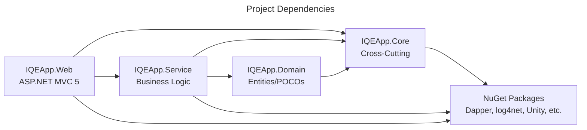
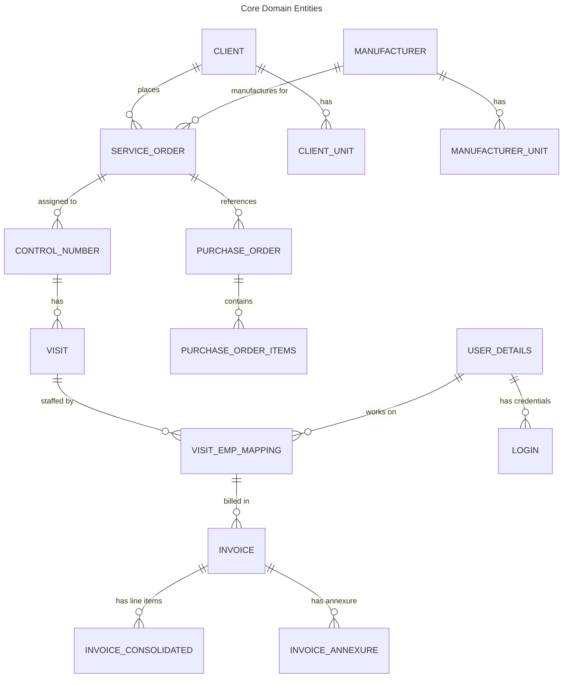

# IQEApp Architecture Diagram

```mermaid
---
title: IQEApp - Ideal Quality Engineers Inspection Management System
---
graph TB
    subgraph Client["Client Layer (Browser)"]
        Browser[HTML / CSS / JS<br/>Bootstrap 5, jQuery, jsTree]
    end

    subgraph Web["Presentation Layer - IQEApp.Web"]
        direction TB
        OWIN[OWIN / Katana<br/>Forms Auth + Identity]
        MVC[ASP.NET MVC 5 Controllers]
        WebAPI[ASP.NET Web API]
        Views[Views / ViewModels]
        Filters[CustomAuthorize<br/>HandleError]
        Bundles[BundleConfig<br/>CSS/JS Bundling]
    end

    subgraph Service["Business Logic Layer - IQEApp.Service"]
        direction TB
        LoginS[LoginService]
        SOService[ServiceOrderService]
        VisitService[VisitProcessingService]
        InvoiceService[InvoiceService]
        ReportService[ReportService]
        ClientService[ClientService]
        UserService[UserService]
        ControlNumService[ControlNumberService]
        PurchaseOrderSvc[PurchaseOrderService]
        MasterService[MasterService]
        FileService[FileService]
        DocService[DocumentService]
        PaymentService[PaymentService]
        CreditorService[CreditorsService]
        DebtorService[DebtorsService]
        HomeService[HomeService]
        SecurityService[SecurityService]
    end

    subgraph Domain["Domain Model Layer - IQEApp.Domain"]
        direction TB
        BaseDomain[BaseDomainModel<br/>UserId, SiteId, LoginUserId]
        ServiceOrderDomain[ServiceOrderDomainModel]
        VisitProcessingDomain[VisitProcessingDomainModel]
        InvoiceDomain[InvoiceDomainModel]
        ClientDomain[ClientDomainModel]
        ControlNumDomain[ControlNumberDomainModel]
        PurchaseOrderDomain[PurchaseOrderDomainModel]
        UserDomain[UserDomainModel]
        ReportDomain[ReportsDomainModel]
    end

    subgraph Core["Cross-Cutting Layer - IQEApp.Core"]
        direction TB
        Cache[CacheProvider<br/>MemoryCache]
        Session[WISession<br/>HttpContext Session]
        Extensions[Extensions<br/>Password, DataTable]
    end

    subgraph Data["Data Access & Storage"]
        direction TB
        Dapper[Dapper ORM<br/>Stored Procedures]
        SqlServer[(SQL Server<br/>IQEIMS_DEV / IQEIMS)]
        AzureBlob[Azure Blob Storage<br/>File Uploads]
        FileSystem[Physical File System<br/>D:\\IQEApp\\FileStorage\\]
    end

    subgraph External["External Integrations"]
        SendGrid[SendGrid - Email]
        AzureSMTP[Azure SMTP]
    end

    subgraph PDF["PDF Generation"]
        iTextSharp[iTextSharp]
        itext7[itext7 / pdfhtml]
        Syncfusion[Syncfusion.Pdf]
        SpirePDF[Spire.PDF]
    end

    Browser --> MVC
    Browser --> WebAPI
    MVC --> Views
    OWIN --> MVC
    Filters --> MVC

    MVC --> LoginS
    MVC --> SOService
    MVC --> VisitService
    MVC --> InvoiceService
    MVC --> ReportService
    MVC --> ClientService
    MVC --> UserService
    MVC --> ControlNumService
    MVC --> PurchaseOrderSvc
    MVC --> MasterService
    MVC --> FileService
    MVC --> DocService
    MVC --> PaymentService
    MVC --> CreditorService
    MVC --> DebtorService
    MVC --> HomeService
    MVC --> SecurityService

    LoginS --- Domain
    SOService --- Domain
    VisitService --- Domain
    InvoiceService --- Domain
    ReportService --- Domain
    ClientService --- Domain
    UserService --- Domain
    ControlNumService --- Domain
    PurchaseOrderSvc --- Domain
    MasterService --- Domain
    FileService --- Domain
    DocService --- Domain
    PaymentService --- Domain
    CreditorService --- Domain
    DebtorService --- Domain
    HomeService --- Domain
    SecurityService --- Domain

    LoginS --- Core
    SOService --- Core
    VisitService --- Core
    InvoiceService --- Core
    ReportService --- Core
    ClientService --- Core
    UserService --- Core
    ControlNumService --- Core
    PurchaseOrderSvc --- Core
    MasterService --- Core
    FileService --- Core
    DocService --- Core
    PaymentService --- Core
    CreditorService --- Core
    DebtorService --- Core
    HomeService --- Core
    SecurityService --- Core

    LoginS -- Dapper --> SqlServer
    SOService -- Dapper --> SqlServer
    VisitService -- Dapper --> SqlServer
    InvoiceService -- Dapper --> SqlServer
    ReportService -- Dapper --> SqlServer
    ClientService -- Dapper --> SqlServer
    UserService -- Dapper --> SqlServer
    ControlNumService -- Dapper --> SqlServer
    PurchaseOrderSvc -- Dapper --> SqlServer
    MasterService -- Dapper --> SqlServer
    FileService -- Dapper --> SqlServer
    DocService -- Dapper --> SqlServer
    PaymentService -- Dapper --> SqlServer
    CreditorService -- Dapper --> SqlServer
    DebtorService -- Dapper --> SqlServer
    HomeService -- Dapper --> SqlServer
    SecurityService -- Dapper --> SqlServer

    FileService --> AzureBlob
    FileService --> FileSystem
    InvoiceService --> iTextSharp
    InvoiceService --> itext7
    InvoiceService --> Syncfusion
    InvoiceService --> SpirePDF
    ReportService --> iTextSharp

    SendGrid -.-> Email((Email<br/>Notifications))
    AzureSMTP -.-> Email

    subgraph BusinessWorkflow["Business Workflow"]
        direction LR
        Login["1. Login<br/>Forms Auth"] --> Dashboard["2. Dashboard<br/>Summary Counts"]
        Dashboard --> SO["3. Service Order<br/>Create/Edit/Upload"]
        SO --> CNo["4. Control Number<br/>Assignment"]
        CNo --> Visit["5. Visit Processing<br/>Schedule→Accept→Execute→QC→Finance"]
        Visit --> Invoice["6. Invoice<br/>Generate/Print PDF"]
        Invoice --> Report["7. Reports<br/>Visit/Expense Reports"]
    end
```

---

## Layer Dependency Diagram

---

## Business Entity Relationship

---

## Key Technology Stack

| Layer | Technology | Version |
|-------|-----------|---------|
| **Framework** | .NET Framework | 4.8 |
| **Web** | ASP.NET MVC 5 / Web API 2 | 5.2.7 / 5.2.0 |
| **ORM** | Dapper (primary), EF 6.5.1 (Identity) | 2.1.35 |
| **Database** | SQL Server (Azure SQL) | - |
| **DI** | Unity | 5.11.x |
| **Auth** | Forms Auth + OWIN Cookie + CustomPrincipal | - |
| **Logging** | log4net | 2.0.3 |
| **PDF** | iTextSharp, itext7, Syncfusion, Spire.PDF | - |
| **Excel** | ClosedXML | 0.95.0 |
| **Mapping** | AutoMapper | 4.1.1 |
| **Email** | SendGrid | 9.24.0 |
| **Storage** | Azure Blob + Physical File System | - |
| **Frontend** | Bootstrap 5.3.7, jQuery 3.6.0, jsTree, Dropzone | - |
